<div align="center">

# AlgoMentor

**Veintidós algoritmos interactivos, retos, logros, práctica con detección de errores por habilidad, intercambio de ejercicios e informes PDF de progreso.**

Programación de Aplicaciones de Escritorio · Universidad Americana (UAM) · Ingeniería de Sistemas


</div>

---

## Contenido

1. [Descripción general](#1-descripción-general)
2. [Instalación y ejecución](#2-instalación-y-ejecución)
3. [Módulos de la aplicación](#3-módulos-de-la-aplicación)
4. [Interfaz y animaciones](#4-interfaz-y-animaciones)
5. [Arquitectura del proyecto](#5-arquitectura-del-proyecto)
6. [Decisiones técnicas](#6-decisiones-técnicas)
7. [Persistencia del aprendizaje](#7-persistencia-del-aprendizaje)
8. [Validación y seguridad](#8-validación-y-seguridad)
9. [Pruebas](#9-pruebas)
10. [Trabajo en equipo y convenciones](#10-trabajo-en-equipo-y-convenciones)
11. [Limitaciones y notas de uso](#11-limitaciones-y-notas-de-uso)
12. [Integrantes y distribución de tareas](#12-integrantes-y-distribución-de-tareas)

---

## 1. Descripción general

AlgoMentor es una aplicación de escritorio para aprender algoritmos paso a paso. Cuenta con trece
algoritmos de ordenamiento y dos métodos de álgebra lineal. **Explica cada operación**, verifica
las respuestas del estudiante, clasifica sus errores por habilidad y guarda el historial en PostgreSQL
mediante Hibernate.

### Algoritmos disponibles

| Categoría | Algoritmos |
|---|---|
| Ordenamiento (13) | Bubble Sort, Insertion Sort, Selection Sort, Shell Sort, Quick Sort, Merge Sort, Heap Sort, Cocktail Sort, Comb Sort, Gnome Sort, Counting Sort, Radix Sort y Bucket Sort. |
| Álgebra lineal (2) | Gauss y Gauss-Jordan. |

### Características principales

| Área | Capacidad |
|---|---|
| Simulación | Quince algoritmos con recorrido paso a paso, descripción de la mecánica de cada ordenamiento, generación de entradas y animaciones. |
| Guía de algoritmos | Tabla que compara los trece ordenamientos (técnica, mejor, promedio y peor caso, memoria extra, estabilidad) y explica cómo ordena cada uno. |
| Reproducción | Reproducción automática con cuatro velocidades, vista del arreglo como barras y pseudocódigo con la línea del paso actual resaltada. |
| Búsqueda, grafos y recursividad | Búsqueda lineal y binaria, recorridos BFS y DFS, Dijkstra, Fibonacci con memorización y Torres de Hanoi, con grafo y torres dibujados paso a paso. |
| Retos | Desafío de 60 segundos (predecir el arreglo tras un número de cambios), cuestionario teórico de 10 preguntas generadas al azar y 12 logros. |
| Modo tutor | En Práctica, hasta tres pistas escalonadas que no revelan la respuesta y un consejo según tu error más frecuente. |
| Accesibilidad | Tamaño de letra (cuatro niveles) y alto contraste en el menú Ver; se recuerdan entre ejecuciones. |
| Tutorial | Recorrido guiado que ilumina cada parte de la interfaz; se muestra la primera vez y se repite desde Ayuda, Tutorial de uso (F1). |
| Aritmética | Fracciones exactas con `BigInteger` (`Fraccion`), sin errores de redondeo en matrices. |
| Práctica | Evaluación de arreglos ordenados y operaciones de fila, con detección de errores. |
| Comparación | Métricas de ejecución de los trece algoritmos de ordenamiento. |
| Habilidades | Clasificación de errores en Signos, Fracciones, Aritmetica y Procedimiento. |
| Persistencia | Perfiles, intentos, pasos, errores y progreso mediante Hibernate ORM y PostgreSQL. |
| Informes | Exportación de informes PDF de progreso con JasperReports y consultas HQL. |
| Intercambio API | Importación y exportación de ejercicios JSON mediante una API HTTP local. |
| API externa | Verificación independiente de sistemas lineales mediante math.js. |
| Interfaz | Tema oscuro, animaciones, resaltado de pivotes y barras de progreso. |

---

## 2. Instalación y ejecución

### Requisitos

- JDK 21.
- PostgreSQL 14 o superior (incluye pgAdmin).
- IntelliJ IDEA (opcional): el proyecto usa Maven y el wrapper `mvnw` está incluido.
- Internet para descargar las dependencias de Maven la primera vez y consultar la API externa de math.js.

### 1. Instalar PostgreSQL

Durante la instalación anota la contraseña del usuario `postgres` y deja el puerto por defecto, `5432`.

### 2. Crear la base de datos

En pgAdmin: clic derecho en *Databases* > *Create* > *Database...* y usa el nombre `algomentor`.
O desde SQL:

```sql
CREATE DATABASE algomentor;
```

### 3. Configurar la conexión

Las credenciales **no** se guardan en el repositorio. La aplicación lee `db.local.properties`
desde la raíz del proyecto, archivo incluido en `.gitignore`.

1. Copia `db.local.properties.example` como `db.local.properties`.
2. Edita `db.local.properties` con tus datos:

   ```properties
   db.url=jdbc:postgresql://localhost:5432/algomentor
   db.user=postgres
   db.password=LA_CONTRASEÑA_DE_POSTGRES
   ```

### 4. Crear el esquema

Ejecuta en la base `algomentor` el archivo `src/main/resources/ni/edu/uam/algomentor/db/schema.sql`.
El script define las tablas y sus relaciones, incluyendo `cuenta`, crea las cuatro habilidades
iniciales (Signos, Fracciones, Aritmetica y Procedimiento) y registra los quince algoritmos del catálogo.

**Bases existentes:** al abrir la aplicación se crea la tabla de cuentas si falta, sin recrear ni
borrar datos (también puedes ejecutar manualmente
`src/main/resources/ni/edu/uam/algomentor/db/actualizar-cuentas.sql`). Un perfil antiguo se puede reclamar
al registrarse con el mismo nombre de usuario (sin distinguir mayúsculas); se conserva su
progreso y ese perfil solo puede quedar vinculado a una cuenta.

**Administradores:** toda cuenta nueva es `USUARIO`; la aplicación no permite crear administradores.
Para promover una cuenta, edita el usuario en
`src/main/resources/ni/edu/uam/algomentor/db/promover-administrador.sql` y ejecútalo en PostgreSQL
(el rol `rol` se agrega solo al abrir la aplicación). Los administradores ven el menú **Administración**
con el Resumen general (todos los perfiles y ejercicios); el servicio que entrega esos datos vuelve a
comprobar el rol en la base de datos, así que ocultar el menú no es la única protección.

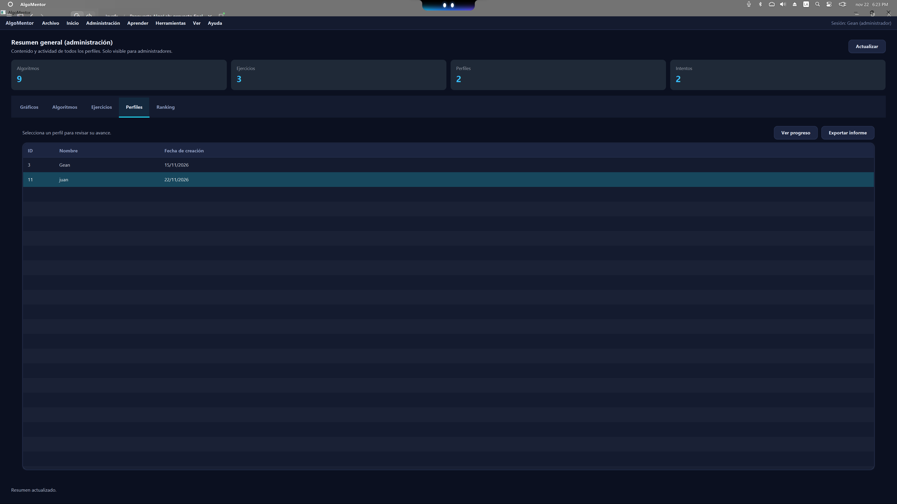

En el Resumen general, la pestaña **Perfiles** permite elegir un perfil (también con clic derecho) y usar **Ver progreso** (abre
el progreso de esa persona, con un botón para volver) o **Exportar informe** (PDF de ese perfil). La
pestaña **Ranking** ordena a todos los perfiles por intentos correctos y luego por porcentaje de acierto.
**Archivo > Exportar informe de progreso** también deja a un administrador elegir de qué perfil quiere el PDF.
Un usuario normal solo puede ver y exportar su propio progreso: `AutorizacionService.exigirAccesoAPerfil`
se comprueba en cada consulta y en cada informe.

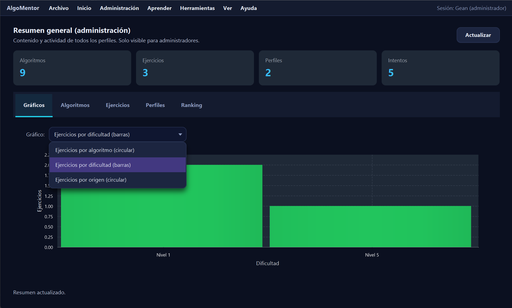

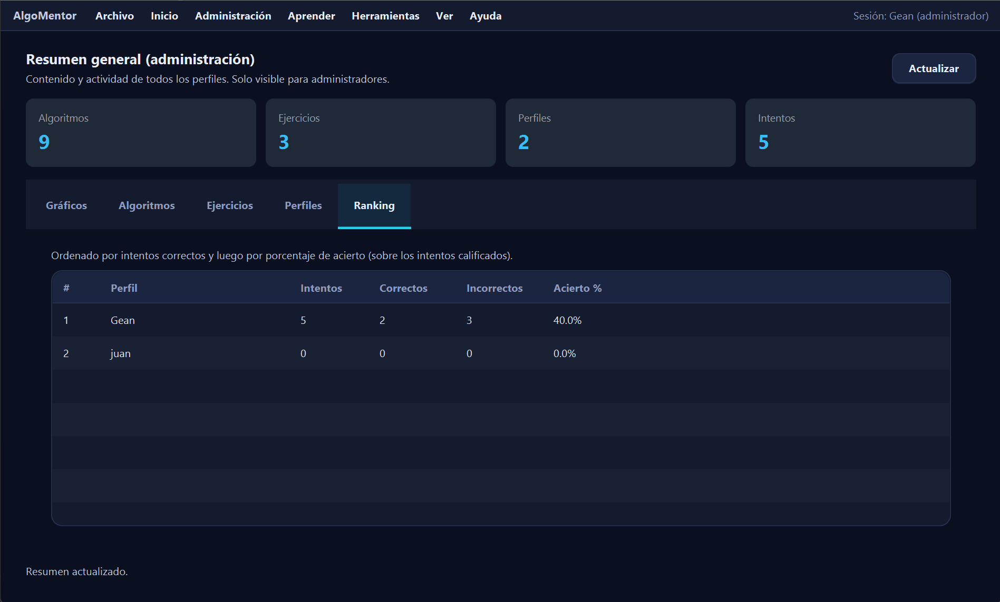

**Instalaciones existentes:** al abrir la aplicación se agregan los algoritmos faltantes a la base.
También puedes ejecutar manualmente el script
[`actualizar-nuevos-algoritmos.sql`](src/main/resources/ni/edu/uam/algomentor/db/actualizar-nuevos-algoritmos.sql).
La migración es transaccional e idempotente (`ON CONFLICT (nombre) DO NOTHING`): agrega los cinco
algoritmos nuevos sin eliminar ni modificar perfiles, ejercicios, intentos, progreso o algoritmos
existentes. No es necesario recrear la base.

### 5. Ejecutar

Abre la carpeta en IntelliJ IDEA como proyecto Maven con JDK 21, o desde una terminal en la raíz:

```powershell
.\mvnw.cmd javafx:run
```

La aplicación inicia en la pantalla de acceso. Crea una cuenta con un usuario de 3 a 40
caracteres y una contraseña de 8 a 128 caracteres, o inicia sesión. Cada cuenta queda
vinculada a un perfil; al registrar el nombre de un perfil previo se conserva su progreso.
Las contraseñas se almacenan con PBKDF2 y no en texto plano; la pantalla de acceso puede recordar solo tu nombre de usuario (nunca la contraseña) y **Archivo > Cambiar contraseña** pide la actual antes de guardar la nueva. Los campos de contraseña tienen una casilla **Mostrar contraseña** para revisar lo que escribes. Usa **Archivo > Cerrar sesión** para salir. La gestión de contenido permite crear, consultar, actualizar y
eliminar algoritmos y ejercicios. El **Resumen general** (menú **Administración**) es solo para administradores: incluye un selector de gráficos (ejercicios por algoritmo, por dificultad y por origen) y muestra los totales y listados de
algoritmos, ejercicios y perfiles, además del total de intentos.
Si la conexión a PostgreSQL falla, la aplicación muestra el problema en la barra inferior y registra
el detalle técnico en consola.

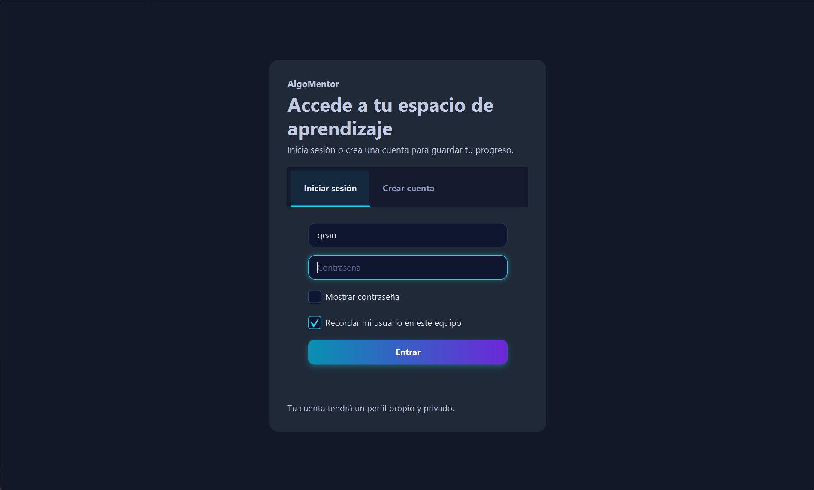

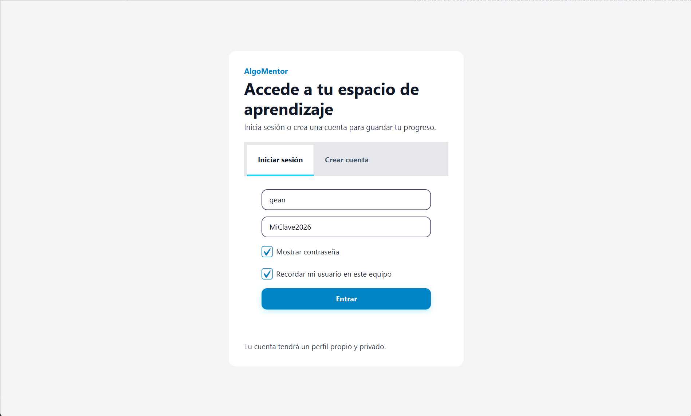

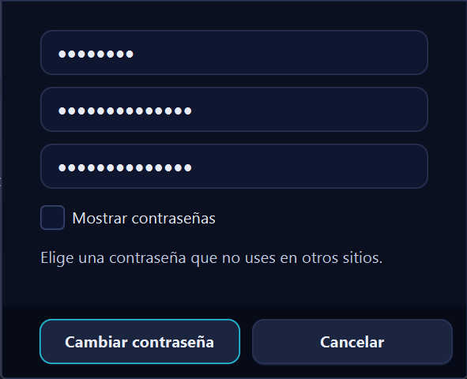

### Dependencias

| Librería | Uso |
|---|---|
| JavaFX 21 | Interfaz gráfica (FXML, CSS, animaciones). |
| Hibernate ORM 6.6 | Mapeo de las entidades y consultas HQL. |
| PostgreSQL JDBC 42.7 | Controlador de la base de datos. |
| JasperReports 7 | Compilación de la plantilla JRXML y exportación a PDF. |
| Jackson 2.18 | Procesamiento JSON para el intercambio de ejercicios y la comunicación con math.js. |
| JUnit 5 | Pruebas unitarias y de integración. |

---

## 3. Módulos de la aplicación

Tras iniciar sesión, la ventana principal tiene una **barra lateral** con las secciones y una barra superior con
tres menús. El indicador de color se desliza hasta la sección activa; el botón de las tres rayas contrae la barra
a solo íconos (se recuerda entre ejecuciones) y, contraída, cada ícono muestra su nombre y su atajo al pasar el cursor.

| Grupo de la barra lateral | Secciones |
|---|---|
| **Mi avance** | Mi progreso y Retos y logros. |
| **Aprender** | Simular, Práctica, Guía de algoritmos y Búsqueda y grafos. |
| **Herramientas** | Comparar, Comprobar sistema (math.js) y Biblioteca. |
| **Administración** | Resumen general e Informes. Solo aparece para cuentas administradoras. |

| Menú superior | Opciones |
|---|---|
| **Archivo** | Exportar ejercicios, Importar ejercicios, Exportar informe de progreso (PDF; un administrador elige primero el perfil), Cambiar contraseña, Cerrar sesión y Salir. |
| **Ver** | Tema claro u oscuro, alto contraste, tamaño de letra y pantalla completa. |
| **Ayuda** | Tutorial de uso y Acerca de AlgoMentor. |

**Clic derecho:** además del menú, casi todas las pantallas tienen un menú contextual.

| Dónde | Opciones |
|---|---|
| Zona libre de cualquier sección | Ir a Mi progreso, Resumen general (admin), Simular, Práctica o Comparar; exportar informe; cambiar tema; pantalla completa. |
| Resumen: Perfiles y Ranking (admin) | Ver progreso, Exportar informe PDF y Copiar fila. |
| Resumen: Algoritmos y Ejercicios | Copiar fila (separada por tabuladores, lista para pegar en Excel). |
| Progreso (página) | Actualizar, Vista previa, Exportar PDF y Exportar CSV. |
| Progreso: tablas | Copiar fila; en Historial, también Exportar CSV. |
| Biblioteca: ejercicios y algoritmos | Eliminar ejercicio, Limpiar selección y Copiar fila. |

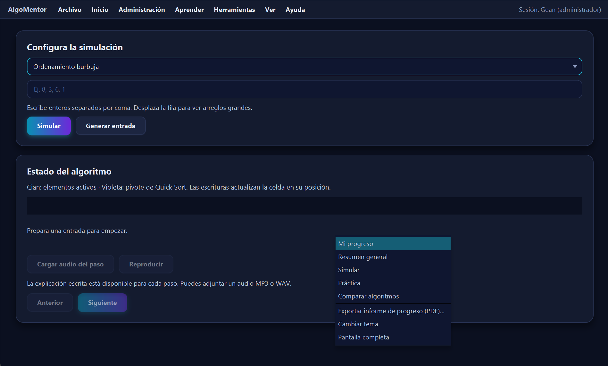

Atajos de teclado (en macOS, `Cmd` en lugar de `Ctrl`):

| Atajo | Acción | Atajo | Acción |
|---|---|---|---|
| `Ctrl+0` | Resumen general | `Ctrl+5` | Comparar algoritmos |
| `Ctrl+1` | Simular | `Ctrl+6` | Comprobar sistema |
| `Ctrl+2` | Práctica | `Ctrl+7` | Biblioteca de contenido |
| `Ctrl+3` | Mi progreso | `Ctrl+E` | Exportar informe PDF |
| `Ctrl+8` | Guía de algoritmos | `Ctrl+Shift+E` / `Ctrl+I` | Exportar / importar ejercicios |
| `Ctrl+9` | Informes (administradores) | `Ctrl+Shift+8` | Búsqueda, grafos y recursividad |
| `Ctrl+Shift+R` | Retos y logros | `F1` | Tutorial de uso |
| `Ctrl+T` | Tema claro u oscuro | `Ctrl+Shift+L` / `Ctrl+Q` | Cerrar sesión / salir |
| `Ctrl+Shift+P` | Cambiar contraseña | | |
| `F11` | Pantalla completa | | |

Las secciones con datos (Resumen, Progreso, Práctica y Biblioteca) se cargan de nuevo cada vez que se
abren, para mostrar los cambios recientes. Simular, Comparar y Comprobar sistema conservan
lo que estabas haciendo.

**Actualización automática:** Resumen y Progreso consultan la base de datos cada 10 segundos y cuando la
ventana recupera el foco, por ejemplo después de importar ejercicios con Postman. Solo redibujan si los
datos cambiaron, así que no pierden la selección ni parpadean; **Actualizar** sigue disponible para forzarlo.

### 3.1 Simulador

La aplicación inicia con el tema oscuro; usa **Ver > Tema claro** para alternar su apariencia; la elección se recuerda al cerrar y volver a abrir la aplicación, y también se aplica en la pantalla de inicio de sesión. La ventana se abre maximizada; **Ver > Pantalla completa** (`F11`) la lleva a pantalla completa real.

1. **Entrada.** Selecciona uno de los quince algoritmos. En Simular puedes introducir enteros
   separados por comas sin un límite fijo de elementos; para Gauss y Gauss-Jordan completa una matriz ampliada. **Generar entrada**
   crea un ejemplo para el método seleccionado.
2. **Recorrido.** Pulsa **Anterior** o **Siguiente** para recorrer las operaciones, sus estados y
   explicaciones en español. Se distinguen las comparaciones, los intercambios, las escrituras,
   las particiones, las mezclas, los conteos y las distribuciones según el algoritmo.
3. **Mecánica.** Al elegir un ordenamiento aparece una descripción breve de cómo ordena. La sección
   **Aprender, Guía de algoritmos** (Ctrl+8) compara todos los métodos en una tabla y en una gráfica.

Quick Sort identifica el pivote en violeta. Los arreglos anchos tienen desplazamiento horizontal.
Las operaciones matriciales usan fracciones exactas; `Clasificador` determina si el sistema tiene
una solución única, infinitas soluciones o ninguna solución.

**Selección de algoritmos**


*Simulador con siete métodos de ordenamiento y dos métodos matriciales.*

**Quick Sort: selección del pivote**

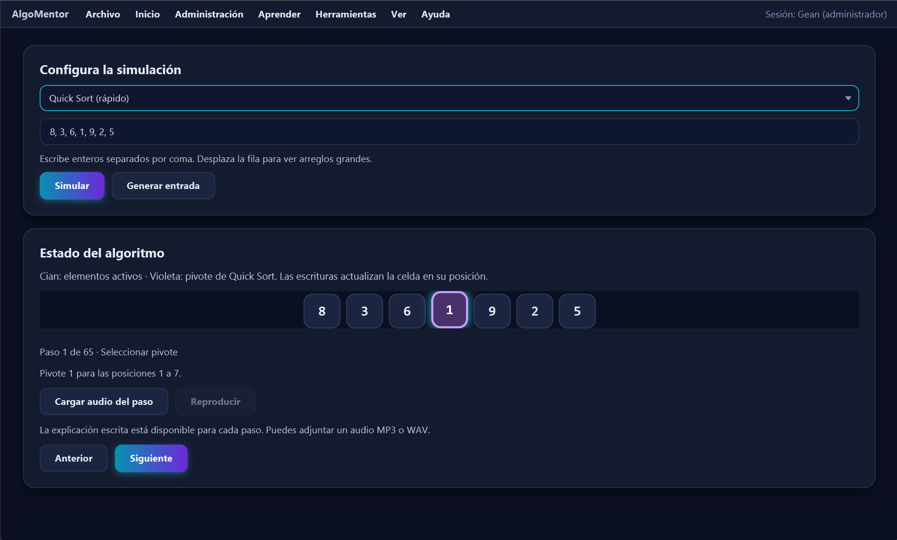

*Primer paso de Quick Sort: selección del pivote de valor 1 en un arreglo de siete elementos.*

**Simulación matricial**


*El simulador muestra la matriz, las celdas activas y la explicación de la operación de fila.*

### 3.2 Práctica

Inicia sesión con tu cuenta y selecciona un ejercicio guardado. La práctica usa el perfil asociado
a la sesión; no permite elegir perfiles ajenos.

- **Ordenamiento:** responde con el arreglo final para cualquiera de los trece métodos.
- **Gauss y Gauss-Jordan:** elige una operación de filas (intercambiar, escalar o eliminar). El formulario
  muestra solo los datos que esa operación necesita (dos filas, una fila y un factor, o fila destino, fila origen
  y factor k) y escribe en vivo la operación, por ejemplo `F2 ← F2 − (3) · F1`; si una fila no existe, se repite
  o el factor no es válido, lo avisa antes de verificar. Después escribe la matriz resultante completa: las celdas
  que cambiaste se resaltan, **Restablecer matriz inicial** vuelve a la matriz del ejercicio y, al verificar,
  las celdas con error quedan marcadas en rojo (en verde si acertaste).

Cada pulsación de **Verificar** registra automáticamente un intento, correcto o incorrecto, para
el perfil autenticado. Las respuestas incompletas o mal escritas también cuentan como intentos
incorrectos. Los errores matriciales identifican la fila y columna correspondientes;
los errores se asocian a Signos, Fracciones, Aritmetica o Procedimiento. Los pasos correctos de práctica
cuentan en Procedimiento. `RegistroPracticaService` conecta la evaluación con `IntentoService`.

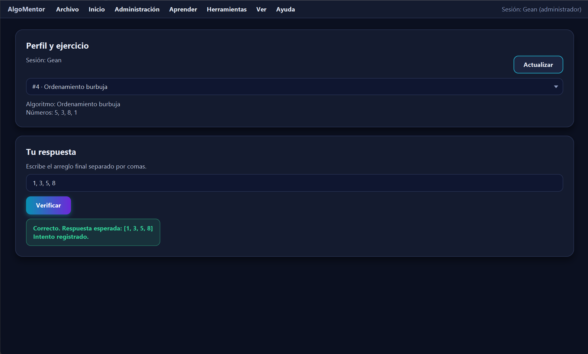

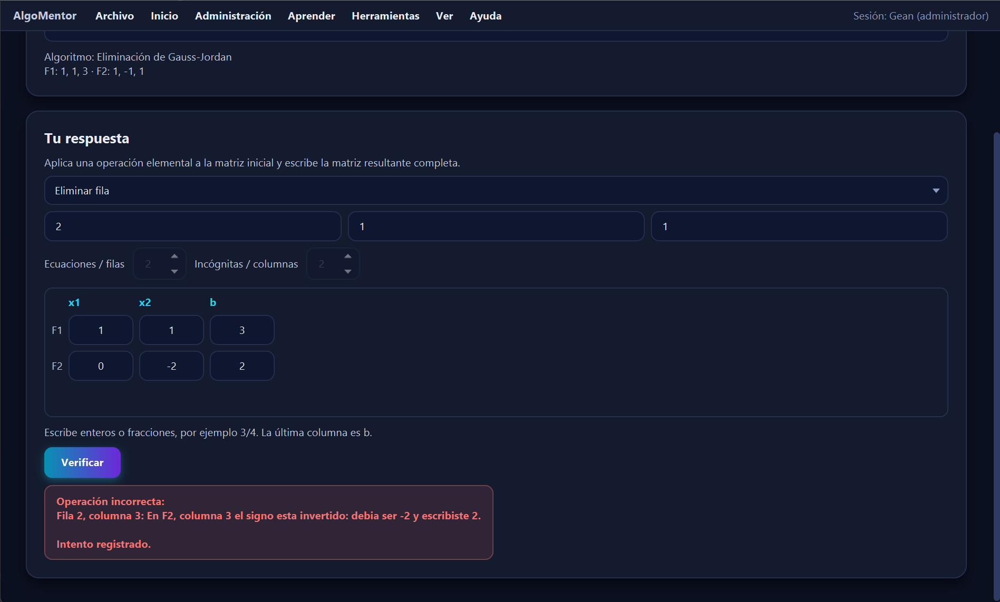

### 3.3 Comparar

**Comparar.** Utiliza el mismo arreglo para analizar los trece ordenamientos. La tabla distingue
comparaciones, intercambios, escrituras en el arreglo, escrituras internas de cubetas, conteos,
distribuciones y pasos educativos. Las métricas describen la traza del método, no un tiempo de ejecución.


*Los siete métodos reciben el mismo arreglo y producen el mismo resultado ordenado, con métricas diferenciadas.*

### 3.4 Progreso e informe PDF

Muestra el progreso del perfil autenticado, no un ranking global. Arriba hay seis tarjetas: intentos,
correctos, incorrectos, porcentaje de acierto (solo sobre los intentos calificados), racha de aciertos
seguidos y tiempo promedio por intento. Debajo, cuatro pestañas:

- **Gráficos:** un selector permite elegir qué gráfico ver: aciertos y errores por habilidad (barras),
  resultados por algoritmo (barras apiladas horizontales, para que se lean los nombres completos), errores por
  tipo (signo, fracción, aritmético y operación inválida), evolución del acierto acumulado (líneas) y
  resultados de los intentos (circular).
- **Detalle:** una barra animada por habilidad: verde desde 70 %, ámbar desde 40 % y roja por debajo.
- **Por algoritmo:** tabla con intentos, correctos, incorrectos y porcentaje de acierto de cada algoritmo.
- **Historial:** los 20 intentos más recientes con fecha, algoritmo, modo, resultado y duración.

Un perfil sin intentos ve un aviso de bienvenida que indica cómo empezar. **Exportar CSV** guarda el historial
(hasta los 200 intentos más recientes) en un archivo que abre Excel; las celdas que parecen fórmulas se
neutralizan para que la hoja de cálculo no las ejecute.

La racha cuenta los aciertos consecutivos más recientes; ignora las simulaciones, que no se califican,
y se reinicia con el primer error. Los datos se obtienen con consultas HQL agrupadas y parametrizadas.

Para revisar o exportar el informe:

1. Abre **Inicio > Mi progreso** después de iniciar sesión (o **Archivo > Exportar informe de progreso**).
2. Pulsa **Vista previa** para abrir el visor de JasperReports, o **Exportar PDF** para guardar el informe.
3. El informe presenta ocho tarjetas (intentos, correctos, incorrectos, sin calificar, porcentaje de acierto,
   racha, tiempo promedio y algoritmos usados) y cuatro tablas: resultados por habilidad, por algoritmo,
   errores por tipo y los 15 últimos intentos, con numeración de páginas.

Cada sección del informe se agrupa por un campo de sección en la plantilla; si todavía no hay datos, la
tabla muestra una fila que lo indica en lugar de desaparecer.
JasperReports compila la plantilla JRXML al generar el informe y obtiene los datos mediante HQL;
no necesita consultar una API externa.

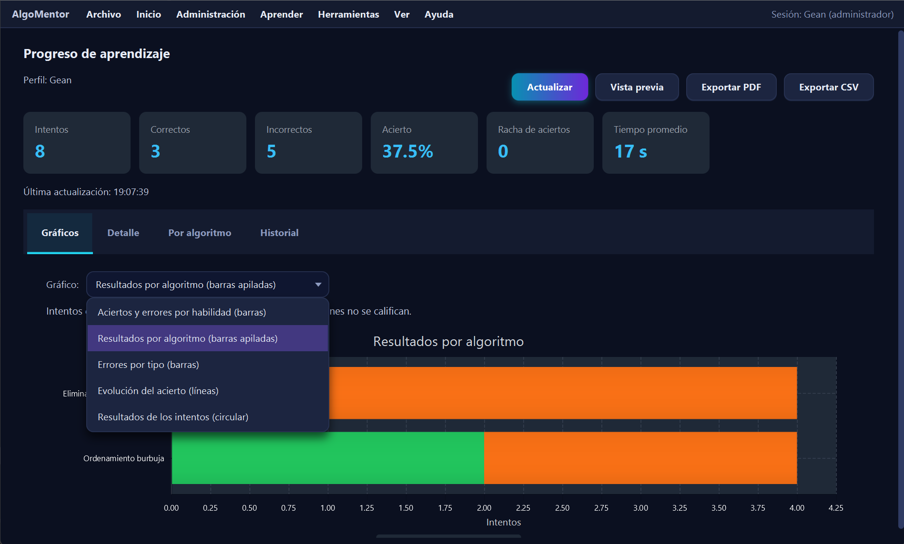

Desde esta misma pantalla también puedes seleccionar un algoritmo y generar una **constancia de
dominio** para el perfil mostrado. Se otorga con al menos 80 % de aciertos sobre los intentos
calificados de ese algoritmo; los intentos sin calificar no entran en el cálculo. Si no se alcanza el
umbral o aún no hay intentos, el PDF de una página muestra el progreso y recomienda practicar cinco
ejercicios de dificultad 1 o 2.

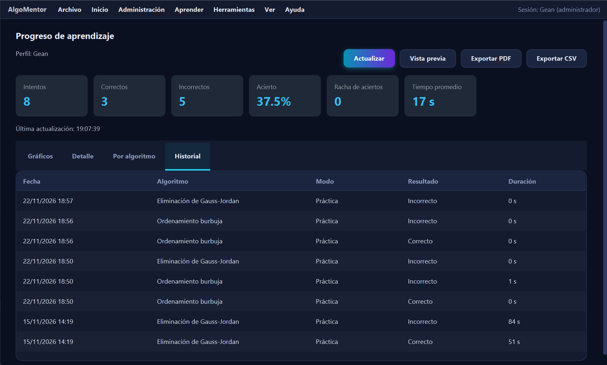

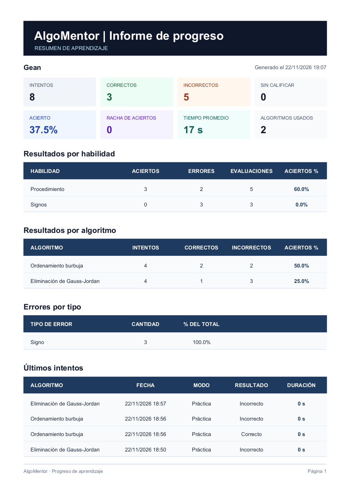

#### Panel de informes (administradores)

**Administración > Informes** (`Ctrl+9`, o clic derecho en una zona libre) abre una lista de informes globales.
Al elegir uno se ve su descripción y lo que incluye, y se puede abrir la **Vista previa** o **Exportar PDF**.
Cada informe vuelve a comprobar en el servicio, con una consulta a la base de datos, que quien lo pide sea
administrador.

El primero es el **informe del catálogo**: ocho tarjetas (algoritmos, de ordenamiento, matemáticos, ejercicios,
acierto global, intentos totales, dificultad media y algoritmos sin ejercicios) y cuatro secciones: algoritmos con
sus ejercicios, intentos y porcentaje de acierto, ejercicios por dificultad, ejercicios por origen y los diez
ejercicios más usados. Usa la plantilla `catalogo.jrxml`, `CatalogoDAO` y `ReporteCatalogoService`.

**Dificultad real de los ejercicios** compara el nivel asignado (1–5) con el porcentaje de acierto de
todos los ejercicios; cuenta únicamente intentos `PRACTICA` con `correcto` distinto de `null`.
Incluye resumen general y tabla por ejercicio, con los mal calibrados resaltados en rojo.
Con menos de 10 intentos evaluados indica **DATOS INSUFICIENTES**; sin intentos muestra «—» como porcentaje.
Desde 10 intentos, indica **BIEN CALIBRADO** dentro de estos rangos inclusivos y **MAL CALIBRADO** fuera:
nivel 1: 70–100 %, nivel 2: 55–85 %, nivel 3: 35–65 %, nivel 4: 15–45 %, nivel 5: 0–30 %.
Son **reglas heurísticas provisionales y ajustables, no criterios científicos**, centralizadas en
`CalibracionDificultad`; el diagnóstico usa el porcentaje sin redondear. Cada intento cuenta (no se
deduplican estudiantes). El acierto global se calcula sobre la suma de intentos evaluados, no promediando
porcentajes por ejercicio. El informe es de solo lectura: no cambia niveles ni tablas de PostgreSQL.
Usa `DificultadRealDAO`, `ReporteDificultadRealService` y `dificultad-real.jrxml`, con los mismos permisos,
vista previa y exportación del panel. Sus pruebas de consulta usan H2 en memoria, únicamente en tests.

**Mapa de calor de errores por perfil** cruza todos los perfiles registrados con las cuatro categorías
de `ErrorDetectado` (`SIGNO`, `FRACCION`, `ARITMETICO` y `OPERACION_INVALIDA`), conservando los perfiles sin
fallos. Incluye resumen global del grupo, orientación docente automática y una matriz térmica con cuatro
niveles de intensidad cromática (sin errores, bajo, medio y alto/crítico) calculados de forma proporcional
sobre el máximo observado. Usa `MapaCalorErroresDAO`, `ReporteMapaCalorService` y `mapa-calor.jrxml`, con
los mismos permisos de administrador, vista previa y exportación a PDF.

Para agregar otro informe se crea una clase que implemente `InformeAdministrativo` (título, descripción,
apartados, nombre de archivo y `prepararReporte`) y se suma en `RegistroInformes` con `informes.add(...)`; la lista,
la vista previa y la exportación funcionan sin tocar la interfaz.

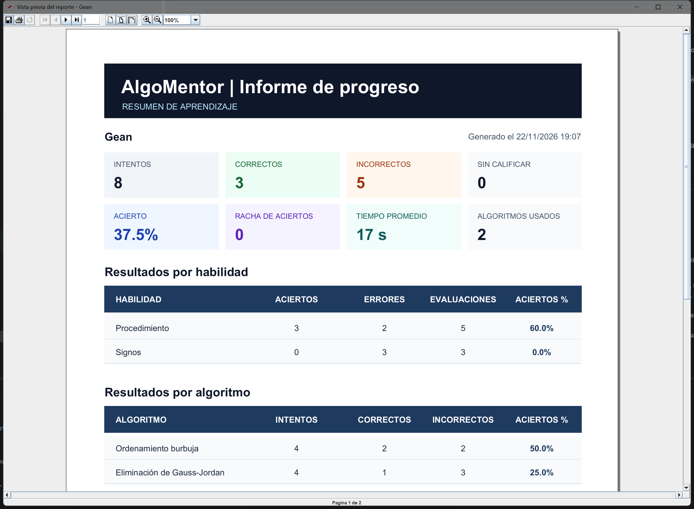

### 3.5 Exportar e importar ejercicios (API local)

La API HTTP local escucha en `127.0.0.1:8765`. JavaFX la consume para exportar e importar ejercicios
JSON portables, sin depender de Internet ni compartir los identificadores internos de PostgreSQL.
Ambas instalaciones deben tener registrados los algoritmos con sus nombres originales.

| Método | Endpoint | Función |
|---|---|---|
| GET | `/api/ejercicios/exportar` | Exporta los ejercicios. |
| POST | `/api/ejercicios/importar` | Importa un paquete JSON. |

Ejemplo de paquete JSON (versión 1):

```json
{
  "version": 1,
  "ejercicios": [
    {
      "algoritmo": "Quick Sort",
      "datos": "8,3,6,1",
      "dificultad": 2,
      "origen": "MANUAL"
    }
  ]
}
```

La importación acepta hasta 500 ejercicios y 1 MB por lote, con `Content-Type: application/json`.
Se procesa en una sola transacción: si algún dato es inválido, no se guarda el lote. Los ejercicios
idénticos se omiten. Para pasar ejercicios a otro equipo se envía el archivo exportado (**Archivo > Exportar ejercicios**) y se importa desde
la instalación receptora (**Archivo > Importar ejercicios**); el servidor no se expone a la red.

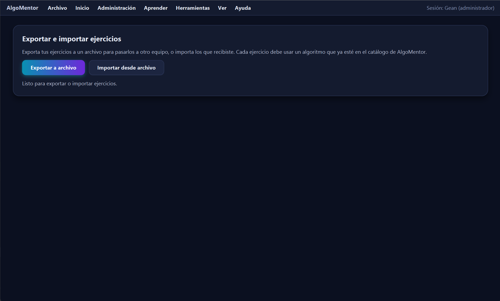

<!-- CAPTURA: Importación desde Postman
 -->

### 3.6 Verificar sistema API

Este módulo consume el servicio externo [math.js](https://api.mathjs.org/) para verificar de forma
independiente un sistema lineal de solución única.

1. Abre **Aprender > Comprobar sistema** e introduce una matriz ampliada de un sistema cuadrado.
   Por ejemplo, las filas `2,1,5` y `1,-1,1`.
2. El motor de Gauss calcula la solución exacta con fracciones.
3. `MathJsClient` envía los coeficientes y términos independientes por HTTPS a
   `https://api.mathjs.org/v4/` mediante una petición POST JSON.
4. La aplicación muestra ambas soluciones como decimales con hasta seis cifras y el tiempo de cada
   operación por separado. AlgoMentor conserva el cálculo exacto con fracciones internamente.
   El tiempo externo incluye la preparación de la petición y la comunicación por Internet,
   por lo que no mide únicamente el cálculo de math.js.

Requiere Internet. Si la API falla, la solución local permanece visible. Los sistemas sin solución
única se clasifican localmente y no se envían a math.js.

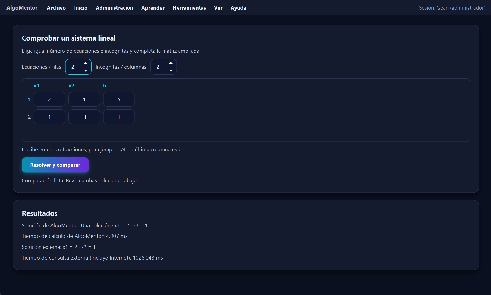

*La solución del motor de AlgoMentor y la respuesta externa coinciden: x1 = 2, x2 = 1.*

### 3.7 Biblioteca (gestión de contenido)

| Pestaña | Función |
|---|---|
| Algoritmos | Consultar y actualizar las fichas existentes. La interfaz no permite crear ni eliminar algoritmos. |
| Ejercicios | Generar ejercicios por algoritmo y dificultad, revisar los datos y realizar operaciones CRUD. |
| Consultas | Buscar ejercicios por algoritmo e historial de intentos por perfil mediante HQL. |

No se puede eliminar un algoritmo que tenga ejercicios relacionados; primero deben eliminarse esos
registros según las restricciones de la base. Para que Práctica reconozca un ejercicio, emplea el
nombre registrado en el catálogo. Se admiten datos simples y el formato versionado:

```text
v1;ARREGLO;8,3,6,1
v1;MATRIZ;2x3;2,1,5|1,-1,1
```

Después de actualizar el esquema, selecciona cualquiera de los quince algoritmos, elige la dificultad,
pulsa **Generar ejercicio**, revisa los datos y guarda. El ejercicio queda disponible para Práctica.

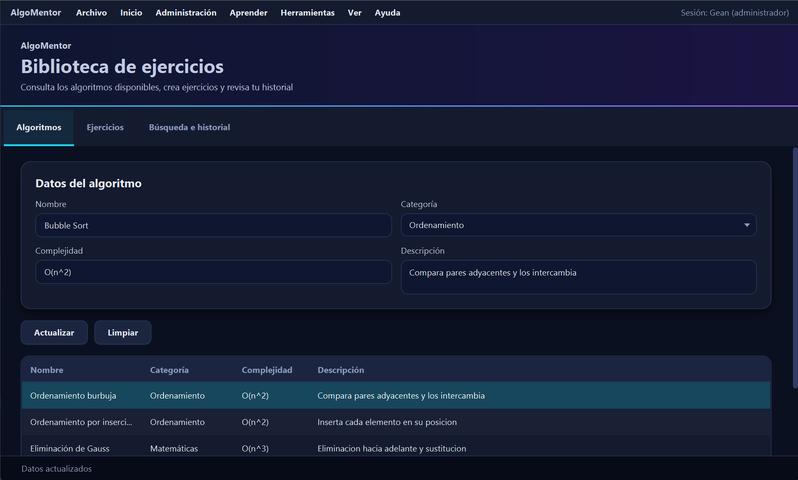

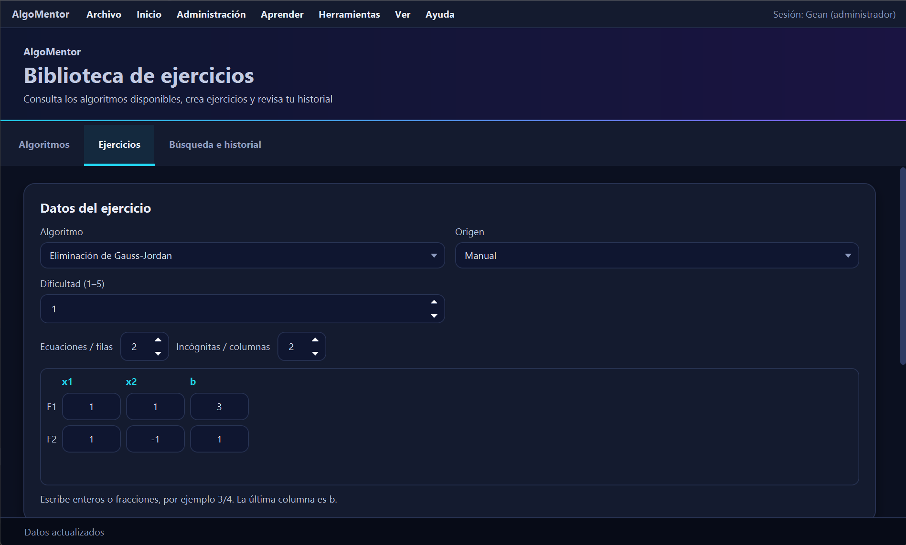

---

## 4. Interfaz y animaciones

- **Tema de vidrio:** `algomentor.css` define la paleta, las tarjetas translúcidas, los botones, las tablas y los
  diálogos, en versión oscura y clara. Detrás de todo hay un fondo de malla de gradiente (`Fondo`: manchas de color
  difuminadas y, en el oscuro, partículas tenues), que en la aplicación es estático y se guarda en caché para no
  gastar procesador. `Tema` aplica la misma hoja de estilos a los cuadros de alerta.
- **Barra lateral:** `BarraLateral` construye la navegación con íconos vectoriales (`Iconos`, formas SVG en el CSS) y
  un indicador que se desliza con la animación de la sección elegida. Los atajos de teclado se registran en la
  escena, de modo que siguen funcionando sin menús.
- **Efectos de botón:** `EfectosBoton` pone un ícono a cada botón según su texto y le da su animación: Actualizar
  gira, Exportar e Importar sacan y meten la flecha, Generar y Limpiar giran, Simular y Ver pulsan. Guardar y
  Verificar cambian el ícono por un check verde (o una cruz roja si falla) y Eliminar encoge el botón hasta un
  círculo y abre y cierra la tapa de una papelera. Las que pueden fallar o cancelarse (guardar, eliminar, verificar)
  las lanza el controlador cuando la acción termina bien, no al hacer clic.
- **Animaciones:** `Animaciones` reúne las transiciones de JavaFX. Las pestañas y las tarjetas aparecen
  de forma escalonada, los botones reaccionan al pasar el cursor y al pulsarlos, y la retroalimentación
  de Práctica e Intercambio API aparece con un estado correcto o de error.
- **Simulador:** las celdas aparecen con rebote al simular. Cuando cambia el estado entre pasos, las
  celdas de un arreglo se deslizan de su posición anterior a la nueva (`MovimientoCeldas` calcula ese
  desplazamiento) y las celdas activas pulsan. Las escrituras se animan en su posición, sin simular
  intercambios inexistentes; el pivote de Quick Sort se resalta en violeta. En las matrices se resaltan
  las celdas que cambiaron.
- **Inicio de sesión:** fondo con orbes de luz que flotan y respiran, tarjeta que entra con rebote y
  campos que aparecen en cascada; si las credenciales fallan, la tarjeta se sacude.
- **Contadores y tarjetas:** las cifras de Resumen y Progreso cuentan hasta su valor (solo animan si
  cambian, para no reiniciarse con la actualización automática) y las tarjetas pequeñas de resumen se elevan
  un poco al pasar el cursor. Al entrar a la aplicación la pantalla se funde suavemente.
- **Reproducción y pseudocódigo:** el simulador puede avanzar solo (lenta, normal, rápida o muy rápida),
  mostrar el arreglo como barras con altura proporcional al valor y resaltar en `Pseudocodigo` la línea que
  ejecuta cada paso. Cada línea declara los tipos de operación que realiza, y una prueba comprueba que todo
  paso real de todo algoritmo tenga una línea que resaltar.
- **Grafos y recursividad:** `AlgoritmosExtra` produce pasos con un `EstadoVisual` (celdas, grafo o torres) que
  la vista dibuja; el grafo de ejemplo es fijo (`GrafoEjemplo`) y los recorridos son deterministas.
- **Retos y logros:** `DesafioService`, `CuestionarioService` y `LogrosService` son lógica pura con pruebas. Los
  mejores puntajes se guardan en las preferencias del equipo (`PuntajesLocales`), no en PostgreSQL; los logros
  de práctica se calculan con las estadísticas ya existentes.
- **Accesibilidad:** las fuentes del CSS usan `em`, de modo que cambiar el tamaño base escala toda la
  interfaz; el alto contraste redefine la paleta con la clase `alto-contraste`.
- **Tutorial:** `Tutorial` oscurece la ventana, ilumina un elemento a la vez con un hueco animado y
  coloca una tarjeta explicativa al lado (Siguiente, Anterior, Omitir; también flechas y Esc). Se muestra
  la primera vez y se repite desde Ayuda. Está inspirado en el recorrido de la calculadora de matrices.
- **Progreso:** las barras por habilidad se animan hasta su porcentaje y no se reinician al reutilizar celdas de la tabla.

---

## 5. Arquitectura del proyecto

```text
src/main/java/ni/edu/uam/algomentor/
├── Launcher.java, MainApp.java       Punto de entrada y navegación principal
├── controller/                      Controladores JavaFX de los módulos de Aprender y Biblioteca
├── engine/                          Motor independiente de JavaFX y PostgreSQL
│   ├── AlgoritmoOrdenamiento         Contrato de los ordenamientos
│   ├── BubbleSort, InsertionSort      Ordenamientos por comparación
│   ├── QuickSort, MergeSort          División y conquista
│   ├── CountingSort, RadixSort       Ordenamiento por frecuencias y dígitos
│   ├── BucketSort                    Distribución en cubetas
│   ├── Gauss, GaussJordan            Métodos matriciales con fracciones exactas
│   ├── CatalogoAlgoritmos            Registro centralizado de algoritmos
│   ├── Paso, TrazaOrdenamiento       Registro de estados y operaciones educativas
│   ├── Fraccion, Clasificador        Aritmética exacta y clasificación de sistemas
│   └── VerificadorOperaciones        Verificación de operaciones de filas
├── service/                         Evaluación, registro de intentos, progreso,
│                                    comparador e informes PDF
├── dao/                             CRUD genérico, acceso a datos y consultas HQL
├── model/                           Entidades persistentes del aprendizaje y cuentas
├── api/                             Intercambio JSON por HTTP y cliente math.js
└── util/                            Hibernate, validaciones, tema y animaciones

src/main/resources/ni/edu/uam/algomentor/
├── view/                            Vistas FXML
├── css/algomentor.css               Hoja de estilos
├── db/
│   ├── schema.sql                    Esquema PostgreSQL y datos iniciales
│   └── actualizar-nuevos-algoritmos.sql   Migración idempotente
└── report/                          Plantillas JasperReports

src/test/java/                      Pruebas JUnit e integración
```

### Flujo de los componentes principales

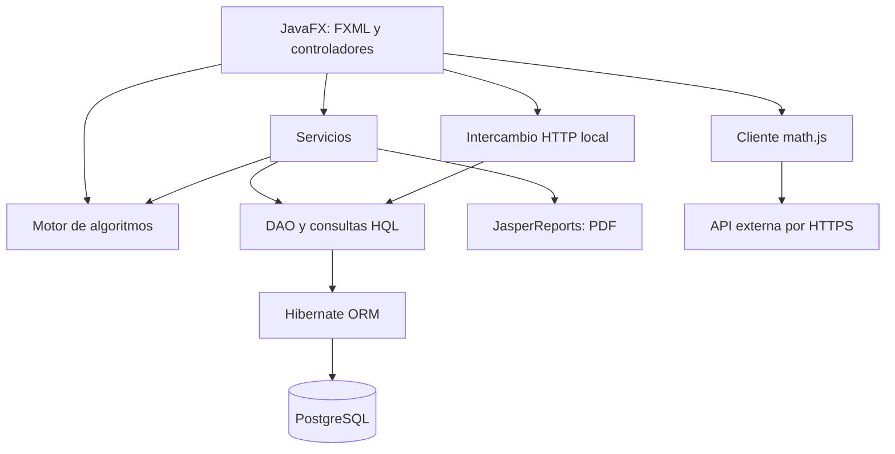

El motor de `engine/` solo calcula y devuelve resultados: no abre ventanas ni consulta la base de
datos. El catálogo centraliza la selección de algoritmos y la traza define las operaciones que
consume el simulador. Los servicios coordinan la lógica de negocio y la persistencia; los DAO
encapsulan el acceso a datos y Hibernate mapea las entidades a PostgreSQL.

Las entidades del aprendizaje son `Perfil`, `Algoritmo`, `Ejercicio`, `Intento`, `PasoIntento`,
`ErrorDetectado`, `Habilidad` y `ProgresoHabilidad`; `Cuenta` guarda las credenciales protegidas
y se vincula a un perfil. JasperReports utiliza las estadísticas de aprendizaje para producir
el PDF; las API ofrecen funciones complementarias sin sustituir el motor local.

---

## 6. Decisiones técnicas

**Fracciones exactas en lugar de punto flotante.** Gauss necesita saber si un elemento es exactamente
cero para elegir pivotes y clasificar el sistema. En `double`, un valor teóricamente nulo puede quedar
en el orden de `1e-17`. `Fraccion` usa `BigInteger`, compara con cero sin tolerancias y mantiene las
fracciones irreducibles.

**Pasos como contrato del motor.** Cada algoritmo devuelve una lista de pasos con su estado y su
explicación. El simulador solo los recorre, y la práctica se apoya en el mismo contrato.

**Formato versionado de datos de ejercicios.** `v1;ARREGLO;…` y `v1;MATRIZ;…` permiten cambiar el
formato sin romper los ejercicios ya guardados; también se aceptan datos simples escritos a mano.

**Trabajo de base de datos fuera del hilo de JavaFX.** Las consultas y los guardados corren en hilos
daemon y la interfaz se actualiza con `Platform.runLater`, de modo que la ventana no se congela.

**Habilidades por nombre, no por ID.** `HabilidadErrorResolver` busca cada habilidad con Hibernate
por su nombre; el código no depende de identificadores fijos de la base.

**Rebote con interpolador propio.** El rebote de las celdas se implementa con un `Interpolator`
personalizado porque `Interpolator.SPLINE` solo admite puntos de control dentro de [0, 1] y el
rebote necesita sobrepasar el valor final.

**Barras de progreso sin repetir animación.** Las celdas de la tabla se reutilizan al desplazarse;
la celda recuerda el último porcentaje animado para no reiniciar la barra.

**Catálogo y trazas reutilizables.** `CatalogoAlgoritmos` centraliza los quince métodos; `TrazaOrdenamiento`
registra estados anteriores y posteriores, índices y explicaciones. El pivote es un dato opcional de
`Paso`, y `TipoOperacion` distingue escrituras, comparaciones y distribuciones reales.

**Intercambio portable.** Los paquetes JSON usan nombres de algoritmos y un formato versionado, en lugar
de IDs locales. La importación valida el lote y utiliza una transacción única.

**Verificación independiente.** El motor local conserva sus fracciones exactas; math.js aporta una
segunda solución mediante una API externa, sin reemplazar la lógica propia.

### Complejidad de los algoritmos

| Método | Funcionamiento | Tiempo | Memoria auxiliar |
|---|---|---|---|
| Bubble Sort | Comparación e intercambio de vecinos | Peor `O(n²)` | `O(1)` |
| Insertion Sort | Inserción en el segmento ordenado | Peor `O(n²)` | `O(1)` |
| Quick Sort | Partición en menores, iguales y mayores que el pivote | Promedio `O(n log n)`, peor `O(n²)` | `O(log n)` |
| Merge Sort | División y mezcla estable | `O(n log n)` | `O(n)` |
| Counting Sort | Conteo de frecuencias y reconstrucción | Denso `O(n + k)`; disperso `O(n log u)` | Denso `O(k)`; disperso `O(u)` |
| Radix Sort | Diez pasadas decimales estables | `O(d(n + b))` | `O(n + b)` |
| Bucket Sort | Distribución en `n` cubetas e inserción interna | Esperado `O(n)` con distribución uniforme; peor `O(n²)` | `O(n)` |
| Gauss | Eliminación hacia forma escalonada | `O(n³)` operaciones aritméticas para un sistema cuadrado | Matriz de `O(n²)` |
| Gauss-Jordan | Reducción hacia forma escalonada reducida | `O(n³)` operaciones aritméticas para un sistema cuadrado | Matriz de `O(n²)` |

`n` representa el número de elementos o incógnitas; `k`, el rango de valores; `u`, el número de
valores distintos; `d = 10` y `b = 10` para Radix Sort. Las cotas describen el método sin la copia
defensiva ni las instantáneas educativas. Cada paso guarda estados completos, por lo que la traza
requiere memoria adicional proporcional al número de pasos y al tamaño del estado. En los métodos
matriciales, el costo de las operaciones con `BigInteger` depende además del tamaño de las fracciones.

Los cinco nuevos ordenamientos aceptan negativos, cero, duplicados y los extremos de `int`, y no
modifican el arreglo recibido. Counting Sort utiliza hasta 65 536 casillas densas; para rangos
mayores usa un árbol de frecuencias dispersas. Radix Sort desplaza las claves en `long` para tratar
correctamente `Integer.MIN_VALUE`, y Bucket Sort realiza sus cálculos de rango en `long`.

### Interpretación de las métricas

El comparador distingue decisiones de orden entre valores, intercambios, escrituras explícitas,
conteos, distribuciones y escrituras internas de cubetas. No cuenta comprobaciones de índices ni la
búsqueda inicial del rango como comparaciones. Las asignaciones de un intercambio no se cuentan
otra vez como escrituras. Dividir, mezclar, seleccionar el pivote y finalizar son pasos educativos;
no equivalen necesariamente a comparaciones. La variante dispersa de Counting Sort sí registra
comparaciones reales de claves; la variante densa no inventa comparaciones de orden.

---

## 7. Persistencia del aprendizaje

AlgoMentor utiliza Hibernate ORM y PostgreSQL para almacenar el historial de aprendizaje. El sistema permite:

- Registrar cuentas vinculadas a perfiles de estudiantes.
- Guardar intentos y sus pasos.
- Asociar errores detectados con habilidades.
- Actualizar aciertos y errores por habilidad.
- Consultar estadísticas mediante HQL.

### Transacciones

El registro de intentos, pasos, errores y, en el modo de práctica, progreso utiliza una única transacción de Hibernate.
Si alguna operación falla, se ejecuta rollback para evitar registros parcialmente guardados.

### Correspondencia de habilidades

`HabilidadErrorResolver` relaciona los errores del motor con las habilidades:

| Error del motor | Habilidad |
|---|---|
| `SIGNO` | Signos |
| `FRACCION` | Fracciones |
| `ARITMETICO` | Aritmetica |
| `OPERACION_INVALIDA` | Procedimiento |

### Concurrencia

`IntentoService` usa un bloqueo pesimista sobre el perfil durante el registro del intento, y las
actualizaciones de progreso se hacen en un orden consistente de identificadores de habilidades.
Estas medidas reducen los conflictos cuando las operaciones pasan por `IntentoService`; las
actualizaciones hechas por otros servicios deben respetar la misma estrategia de bloqueo.

---

## 8. Validación y seguridad

### Validación de entradas

La aplicación controla y explica, con mensajes claros y sin cerrar la ventana, los datos no válidos:
nombres de perfil vacíos o inválidos, arreglos con valores no enteros o con más de 20 elementos en la interfaz,
matrices con filas de distinto tamaño, operaciones de fila con índices fuera de rango, campos
obligatorios de algoritmos y ejercicios, y operaciones sin perfil o ejercicio seleccionado.

La generación y el guardado de ejercicios comparten validaciones de formato, dificultad, origen
y límites visuales con la importación JSON. Los nuevos motores rechazan arreglos vacíos y nulos.

### Seguridad

- **Credenciales fuera del repositorio:** `db.local.properties` está en `.gitignore`; solo se versiona
  `db.local.properties.example`.
- **Roles:** `cuenta.rol` es `USUARIO` por defecto y solo se cambia con SQL; `AutorizacionService` lee el rol
  de la base en cada comprobación y `ResumenAdministracionService` lanza `SecurityException` a quien no sea
  administrador antes de consultar datos globales.
- **Consultas parametrizadas:** las consultas HQL usan parámetros con nombre (`:perfilId`,
  `:algoritmoId`); no se concatena texto del usuario en las consultas.
- **Nombre de archivo del informe:** los caracteres no válidos del nombre del perfil se reemplazan
  antes de proponer el archivo PDF.
- **API local:** escucha únicamente en la interfaz de loopback; valida tamaño del lote y contenido antes de la importación.
- **API externa:** la verificación utiliza HTTPS y envía los coeficientes y términos independientes del sistema.
- **Mensajes de error:** la interfaz muestra un texto comprensible; el detalle técnico y la traza
  se registran en consola.

---

## 9. Pruebas

La última ejecución local (`mvn test` más las pruebas de interfaz JavaFX bajo un display virtual) obtuvo
**345 pruebas aprobadas**, sin fallos ni omisiones. Las pruebas que usan PostgreSQL real
(`PersistenciaAprendizajeIT` y `NuevosAlgoritmosPostgresIT`) necesitan la base de datos y no se declaran
aprobadas en esa ejecución.

### Ejecución

Todas las pruebas unitarias:

```powershell
.\mvnw.cmd clean test
```

Pruebas de carga FXML y controles JavaFX (requieren escritorio):

```powershell
.\mvnw.cmd "-Dtest=InterfazAlgoritmosIT" test
```

Ejecución conjunta de pruebas unitarias e integración JavaFX:

```powershell
.\mvnw.cmd test "-Dtest=*Test,InterfazAlgoritmosIT"
```

Pruebas específicas del informe PDF:

```powershell
.\mvnw.cmd "-Dtest=ReporteProgresoTemplateTest,ReporteProgresoServiceTest,ReporteCatalogoTemplateTest,ReporteCatalogoServiceTest,ReporteDificultadRealTemplateTest,ReporteDificultadRealServiceTest,CalibracionDificultadTest,DificultadRealDAOTest,ReporteMapaCalorTemplateTest,ReporteMapaCalorServiceTest,MapaCalorErroresDAOTest,RegistroInformesTest" test
```

Pruebas de integración con PostgreSQL real (requieren conexión configurada y esquema actualizado):

```powershell
.\mvnw.cmd "-Dtest=PersistenciaAprendizajeIT,NuevosAlgoritmosPostgresIT" test
```

Las clases terminadas en `IT` no se ejecutan automáticamente con `mvn test` y deben solicitarse
explícitamente. Las pruebas de PostgreSQL comprueban persistencia, rollback, migración idempotente,
intercambio de ejercicios, registro de intentos y progreso. Usan registros temporales, que se eliminan
al terminar, sin recurrir a bases de datos alternativas.

### Cobertura por área

| Área | Clases de prueba |
|---|---|
| Ordenamiento | `BubbleSortTest`, `InsertionSortTest`, `QuickSortTest`, `MergeSortTest`, `CountingSortTest`, `RadixSortTest`, `BucketSortTest`, `SelectionSortTest`, `ShellSortTest`, `HeapSortTest`, `CocktailSortTest`, `CombSortTest`, `GnomeSortTest`, `FichaAlgoritmoTest`, `PseudocodigoTest` |
| Álgebra lineal | `GaussTest`, `GaussJordanTest`, `FraccionTest`, `FormatoMatrizTest`, `VerificadorOperacionesTest` |
| Catálogo y ejercicios | `CatalogoAlgoritmosTest`, `CatalogoSqlTest`, `GeneradorEjerciciosTest`, `EvaluadorPracticaTest`, `EvaluadorPasoMatrizTest`, `EntradaAprendizajeTest` |
| Persistencia y servicios | `IntentoServiceTest`, `RegistroPracticaServiceTest`, `ProgresoHabilidadServiceTest`, `PerfilServiceTest`, `HabilidadErrorResolverTest`, `CalculoProgresoTest` |
| Búsqueda, grafos y recursividad | `AlgoritmosExtraTest` |
| Retos, logros y tutor | `RetosServiceTest`, `TutorServiceTest`, `TutorialTest` |
| Comparador | `ComparadorOrdenamientosTest` |
| Barra lateral y efectos de botón | `EfectosBotonTest`, `InterfazLateralIT` |
| Estadísticas | `EstadisticasDAOTest` |
| Informe PDF | `ReporteProgresoTemplateTest`, `ReporteProgresoServiceTest`, `RankingYInformeTest`, `ReporteCatalogoTemplateTest`, `ReporteCatalogoServiceTest`, `ReporteMapaCalorTemplateTest`, `ReporteMapaCalorServiceTest`, `MapaCalorErroresDAOTest`, `RegistroInformesTest` |
| Roles y cuentas | `AutorizacionServiceTest`, `AutenticacionServiceTest`, `LimitadorIntentosTest` |
| Utilidades | `CsvHistorialTest`, `UsuarioRecordadoTest` |
| Constancia de dominio | `ReporteDominioTemplateTest`, `ReporteDominioServiceTest` |
| Intercambio JSON | `EjerciciosApiServerTest`, `PaqueteNuevosAlgoritmosTest` |
| Animaciones y validación | `MovimientoCeldasTest`, `ValidacionesFormularioTest` |
| Integración JavaFX | `InterfazAlgoritmosIT` |
| Integración PostgreSQL | `PersistenciaAprendizajeIT`, `NuevosAlgoritmosPostgresIT` |

Los cinco motores nuevos verifican entradas ordenadas, inversas, repetidas, negativas, cero,
valores extremos, entradas inválidas y conservación del arreglo original. El contrato de pruebas
compartido compara cada implementación con `Arrays.sort` y comprueba la continuidad e índices de
los pasos. `Arrays.sort` sirve como referencia de prueba, no como implementación del motor.

### Guía de verificación manual

| Prueba | Cómo comprobarla |
|---|---|
| Simulación | Seleccionar cada algoritmo; generar una entrada y recorrer los pasos en ambos sentidos. |
| Quick Sort | Comprobar el marcado del pivote y las particiones. |
| Comparación | Introducir `8,3,6,1,5` y verificar las trece filas de resultados. |
| Persistencia de algoritmos y ejercicios | Crear, consultar y actualizar registros desde Biblioteca; verificar restricciones de eliminación. |
| Generación de ejercicios | Elegir el algoritmo y dificultad, generar y guardar el ejercicio. |
| Práctica | Iniciar sesión, elegir un ejercicio y verificar que cada intento se registra en el perfil propio. |
| Progreso | Consultar gráfico y detalle de habilidades del perfil autenticado. |
| Informe PDF | Abrir **Vista previa** o usar **Exportar** y revisar el PDF generado. |
| Constancia de dominio | Elegir un algoritmo; verificar el diploma con 80 % o más y el plan de práctica por debajo del umbral o sin intentos. |
| Intercambio API | Exportar JSON e importar un paquete válido; verificar que los duplicados se omiten. |
| Verificación externa | Resolver las filas `2,1,5` y `1,-1,1` y comparar la respuesta de math.js con Gauss. |

La concurrencia real y el rollback deben comprobarse en PostgreSQL antes de declarar validada la
persistencia de extremo a extremo.

---

## 10. Trabajo en equipo y convenciones

El equipo desarrolla las funcionalidades en ramas independientes y las integra mediante Pull Requests.
La rama `main` debe compilar y ejecutarse después de cada integración.

- **Commits:** formato `tipo: descripción en español`, por ejemplo
  `feat: implementar Gauss y Gauss-Jordan con clasificacion de sistemas`. Tipos usados: `feat`, `fix`,
  `docs`, `test` y `chore`.
- **Ramas:** una por funcionalidad (`feature/…`), y una propia para la documentación (`docs/…`).
- **Código:** nombres en español y descriptivos, comentarios solo para explicar el porqué de una
  decisión, y sin código muerto.
- **Secretos:** nunca se versionan contraseñas ni credenciales.

---

## 11. Limitaciones y notas de uso

- La consola no muestra mensajes de registro (avisos de JavaFX, información de Hibernate ni errores controlados): se guardan, solo avisos y errores, en `~/.algomentor/algomentor-0.log`. Si algo falla, ese archivo dice por qué. `ConfiguracionLogs` lo configura al iniciar la aplicación y las pruebas.
- Simular no impone un máximo fijo de enteros al introducir el arreglo manualmente. La fila se centra cuando cabe y se desplaza hasta el elemento activo durante los pasos. Biblioteca, Práctica y Comparar conservan su límite visual de 20, y el formato de almacenamiento mantiene el límite de 30 por compatibilidad. Los arreglos muy grandes requieren más tiempo y memoria porque se conserva el estado de cada paso.
- Práctica reconoce los quince algoritmos del catálogo. Los ejercicios deben usar los nombres registrados, como `Quick Sort` o `Gauss-Jordan`.
- Ejecuta `schema.sql` en una instalación nueva. En una existente, la aplicación completa automáticamente los algoritmos faltantes sin modificar los registros ya presentes; `actualizar-nuevos-algoritmos.sql` sigue disponible para una migración manual. Las cuatro habilidades iniciales deben estar disponibles antes de registrar intentos.
- La API externa math.js requiere Internet y verifica únicamente sistemas cuadrados con solución única; la solución local sigue disponible ante fallos del servicio.
- El intercambio es local y está limitado a 500 ejercicios y 1 MB por lote. Ambos equipos deben disponer de los algoritmos correspondientes.
- Las trazas guardan instantáneas de los estados: las métricas educativas no representan una medición directa de tiempo ni memoria real de ejecución.
- Hibernate valida el esquema al iniciar (`hbm2ddl.auto=validate`); no lo crea ni lo migra. La única excepción es la tabla `cuenta`, que la aplicación crea si falta antes de validar.
- El inicio de sesión protege el acceso desde la aplicación, no la base de datos: quien abra PostgreSQL directamente puede ver los datos. Las contraseñas se guardan con PBKDF2-HMAC-SHA256 y sal, nunca en texto plano. Tras 5 intentos fallidos seguidos con un usuario, ese usuario queda bloqueado 30 segundos; el contador se guarda en memoria y se reinicia al cerrar la aplicación.
- La carpeta `target/` se genera al compilar y no forma parte del repositorio.
- La última verificación documentada no incluye la ejecución de las pruebas contra PostgreSQL real.

---

## 12. Integrantes y distribución de tareas

| Integrante | Usuario GitHub | Responsabilidades |
|---|---|---|
| Geanfranco Alexander Rodriguez Mendieta | [Geanrm30](https://github.com/Geanrm30) | Estructura del proyecto y configuración de la base, esquema PostgreSQL, mapeo de las ocho entidades, `SessionFactory`, motor de algoritmos (Bubble Sort, Insertion Sort, Gauss y Gauss-Jordan, fracciones exactas, verificador de operaciones y generador de ejercicios), tema visual y animaciones. |
| Anthony Sying Gonzalez Chow | [AnthonySGC](https://github.com/AnthonySGC) | DAO base e interfaz CRUD genérica, persistencia de algoritmos y ejercicios, consultas HQL y estadísticas, gestión y validación de perfiles, registro transaccional de intentos, errores por habilidad, progreso y prueba de integración con rollback. Ampliación de los cinco algoritmos (Quick Sort, Merge Sort, Counting Sort, Radix Sort y Bucket Sort), catálogo, integración con los módulos, migración y pruebas. |
| Jeremy Josue Gradiz Noguera | [JJGradiz](https://github.com/JJGradiz) | Consumo de la API de repaso en la etapa inicial del proyecto; plantilla JasperReports, generación y exportación del informe PDF y sus pruebas. |
| Claudio Antonio De La Rocha Acevedo | [Def-Claudingo](https://github.com/Def-Claudingo) | Experiencia JavaFX: navegación, simulador, práctica con evaluación de operaciones y errores por habilidad, comparador, progreso e integración de la gestión con Hibernate. Intercambio de ejercicios por API, verificación externa con math.js y mejoras de navegación y entrada de matrices. |

Docente: José A. Durán García · Noviembre 2026
