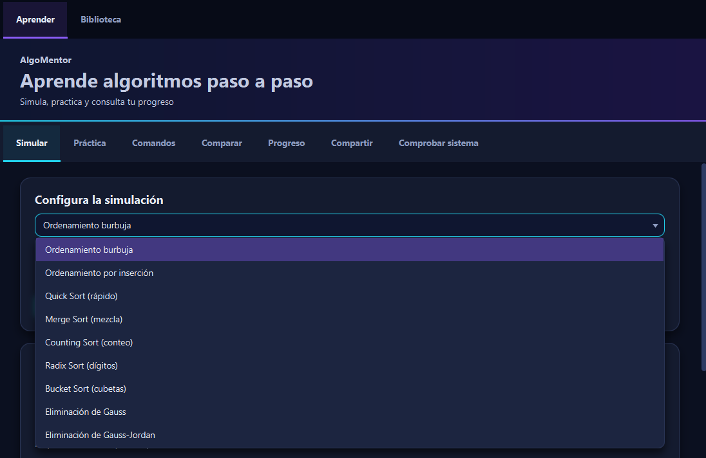
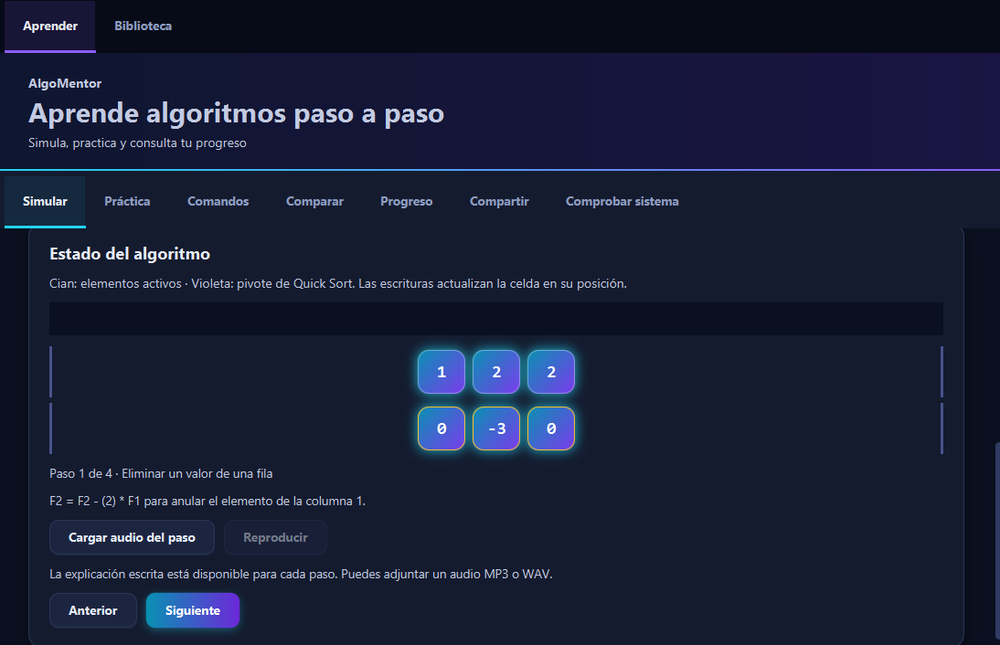
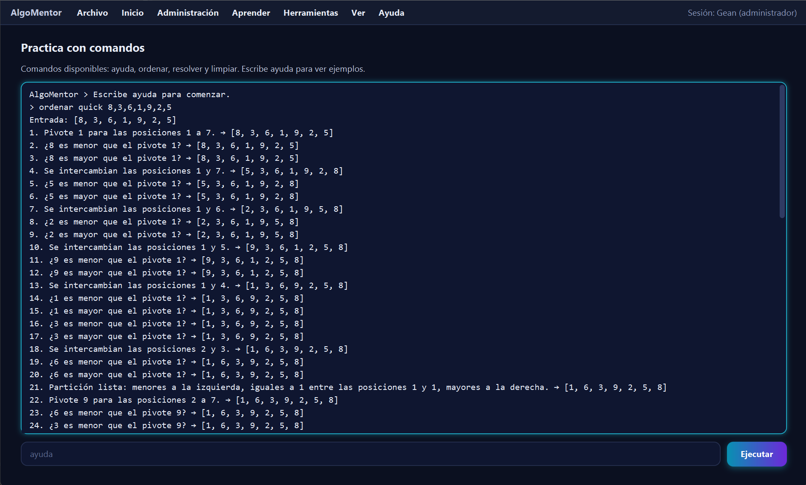
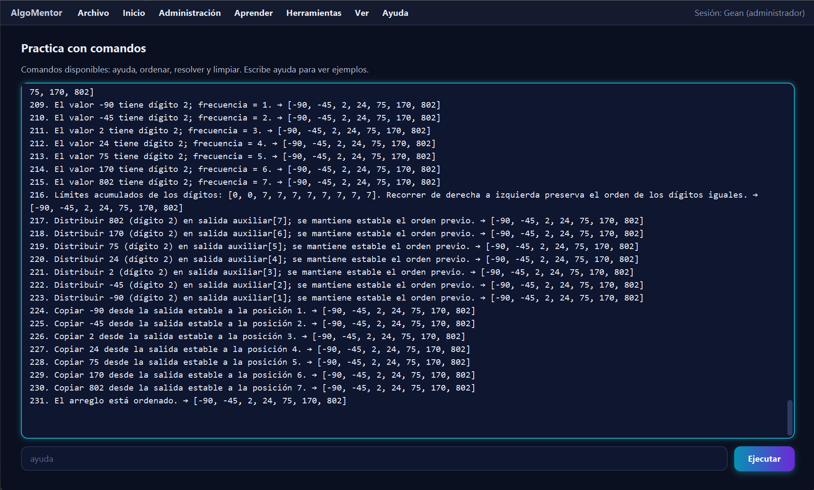
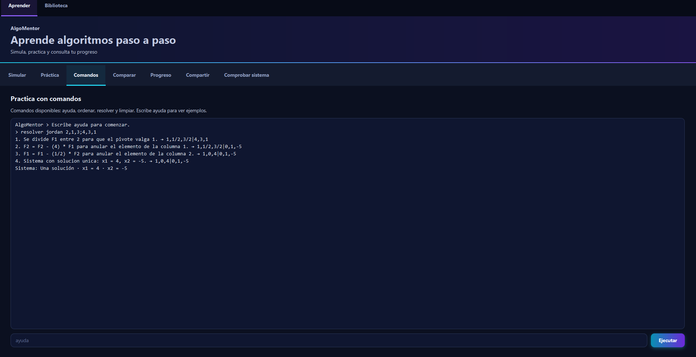
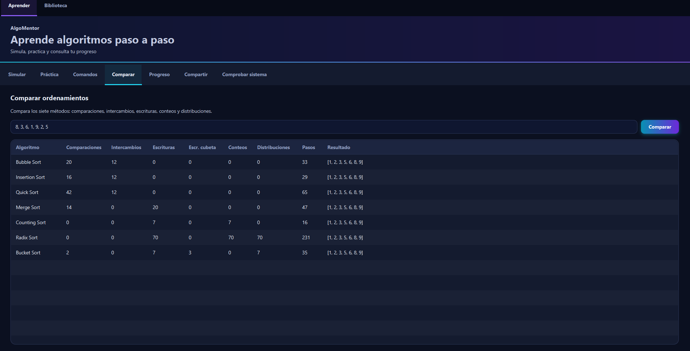
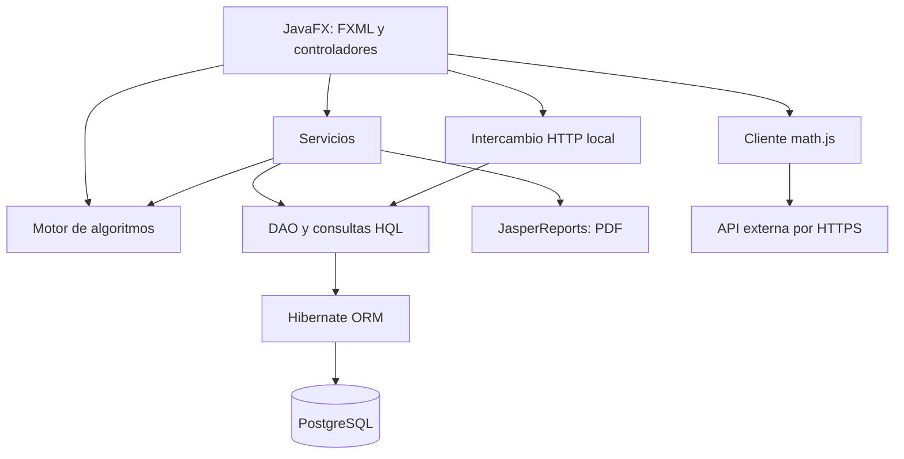

<div align="center">

# AlgoMentor

**Nueve algoritmos interactivos, práctica con detección de errores por habilidad, intercambio de ejercicios e informes PDF de progreso.**

Programación de Aplicaciones de Escritorio · Universidad Americana (UAM) · Ingeniería de Sistemas


</div>

---

## Contenido

1. [Descripción general](#1-descripción-general)
2. [Instalación y ejecución](#2-instalación-y-ejecución)
3. [Módulos de la aplicación](#3-módulos-de-la-aplicación)
4. [Interfaz y animaciones](#4-interfaz-y-animaciones)
5. [Arquitectura del proyecto](#5-arquitectura-del-proyecto)
6. [Decisiones técnicas](#6-decisiones-técnicas)
7. [Persistencia del aprendizaje](#7-persistencia-del-aprendizaje)
8. [Validación y seguridad](#8-validación-y-seguridad)
9. [Pruebas](#9-pruebas)
10. [Trabajo en equipo y convenciones](#10-trabajo-en-equipo-y-convenciones)
11. [Limitaciones y notas de uso](#11-limitaciones-y-notas-de-uso)
12. [Integrantes y distribución de tareas](#12-integrantes-y-distribución-de-tareas)

---

## 1. Descripción general

AlgoMentor es una aplicación de escritorio para aprender algoritmos paso a paso. Cuenta con siete
algoritmos de ordenamiento y dos métodos de álgebra lineal. **Explica cada operación**, verifica
las respuestas del estudiante, clasifica sus errores por habilidad y guarda el historial en PostgreSQL
mediante Hibernate.

### Algoritmos disponibles

| Categoría | Algoritmos |
|---|---|
| Ordenamiento (7) | Bubble Sort, Insertion Sort, Quick Sort, Merge Sort, Counting Sort, Radix Sort y Bucket Sort. |
| Álgebra lineal (2) | Gauss y Gauss-Jordan. |

### Características principales

| Área | Capacidad |
|---|---|
| Simulación | Nueve algoritmos con recorrido paso a paso, generación de entradas, animaciones y audio opcional. |
| Aritmética | Fracciones exactas con `BigInteger` (`Fraccion`), sin errores de redondeo en matrices. |
| Práctica | Evaluación de arreglos ordenados y operaciones de fila, con detección de errores. |
| Comparación | Métricas de ejecución de los siete algoritmos de ordenamiento. |
| Habilidades | Clasificación de errores en Signos, Fracciones, Aritmetica y Procedimiento. |
| Persistencia | Perfiles, intentos, pasos, errores y progreso mediante Hibernate ORM y PostgreSQL. |
| Informes | Exportación de informes PDF de progreso con JasperReports y consultas HQL. |
| Intercambio API | Importación y exportación de ejercicios JSON mediante una API HTTP local. |
| API externa | Verificación independiente de sistemas lineales mediante math.js. |
| Interfaz | Tema oscuro, animaciones, resaltado de pivotes y barras de progreso. |

---

## 2. Instalación y ejecución

### Requisitos

- JDK 21.
- PostgreSQL 14 o superior (incluye pgAdmin).
- IntelliJ IDEA (opcional): el proyecto usa Maven y el wrapper `mvnw` está incluido.
- Internet para descargar las dependencias de Maven la primera vez y consultar la API externa de math.js.

### 1. Instalar PostgreSQL

Durante la instalación anota la contraseña del usuario `postgres` y deja el puerto por defecto, `5432`.

### 2. Crear la base de datos

En pgAdmin: clic derecho en *Databases* > *Create* > *Database...* y usa el nombre `algomentor`.
O desde SQL:

```sql
CREATE DATABASE algomentor;
```

### 3. Configurar la conexión

Las credenciales **no** se guardan en el repositorio. La aplicación lee `db.local.properties`
desde la raíz del proyecto, archivo incluido en `.gitignore`.

1. Copia `db.local.properties.example` como `db.local.properties`.
2. Edita `db.local.properties` con tus datos:

   ```properties
   db.url=jdbc:postgresql://localhost:5432/algomentor
   db.user=postgres
   db.password=LA_CONTRASEÑA_DE_POSTGRES
   ```

### 4. Crear el esquema

Ejecuta en la base `algomentor` el archivo `src/main/resources/ni/edu/uam/algomentor/db/schema.sql`.
El script define las ocho tablas y sus relaciones, crea las cuatro habilidades iniciales
(Signos, Fracciones, Aritmetica y Procedimiento) y registra los nueve algoritmos del catálogo.

**Instalaciones existentes:** al abrir la aplicación se agregan los algoritmos faltantes a la base.
También puedes ejecutar manualmente el script
[`actualizar-nuevos-algoritmos.sql`](src/main/resources/ni/edu/uam/algomentor/db/actualizar-nuevos-algoritmos.sql).
La migración es transaccional e idempotente (`ON CONFLICT (nombre) DO NOTHING`): agrega los cinco
algoritmos nuevos sin eliminar ni modificar perfiles, ejercicios, intentos, progreso o algoritmos
existentes. No es necesario recrear la base.

### 5. Ejecutar

Abre la carpeta en IntelliJ IDEA como proyecto Maven con JDK 21, o desde una terminal en la raíz:

```powershell
.\mvnw.cmd javafx:run
```

Si la conexión a PostgreSQL falla, la aplicación muestra el problema en la barra inferior y registra
el detalle técnico en consola.

### Dependencias

| Librería | Uso |
|---|---|
| JavaFX 21 | Interfaz gráfica (FXML, CSS, animaciones). |
| Hibernate ORM 6.6 | Mapeo de las ocho entidades y consultas HQL. |
| PostgreSQL JDBC 42.7 | Controlador de la base de datos. |
| JasperReports 7 | Compilación de la plantilla JRXML y exportación a PDF. |
| Jackson 2.18 | Procesamiento JSON para el intercambio de ejercicios y la comunicación con math.js. |
| JUnit 5 | Pruebas unitarias y de integración. |

---

## 3. Módulos de la aplicación

La ventana principal tiene dos pestañas: **Aprender** (Simular, Práctica, Comandos, Comparar,
Progreso, Compartir y Comprobar sistema) y **Biblioteca** (gestión de contenido).

### 3.1 Simulador

1. **Entrada.** Selecciona uno de los nueve algoritmos. Para ordenamiento introduce hasta 20 enteros
   separados por comas; para Gauss y Gauss-Jordan completa una matriz ampliada. **Generar entrada**
   crea un ejemplo para el método seleccionado.
2. **Recorrido.** Pulsa **Anterior** o **Siguiente** para recorrer las operaciones, sus estados y
   explicaciones en español. Se distinguen las comparaciones, los intercambios, las escrituras,
   las particiones, las mezclas, los conteos y las distribuciones según el algoritmo.
3. **Audio.** Puedes cargar y reproducir un MP3 o WAV local por paso; el texto permanece visible.
   Los audios no se guardan en PostgreSQL ni se incluyen en el repositorio.

Quick Sort identifica el pivote en violeta. Los arreglos anchos tienen desplazamiento horizontal.
Las operaciones matriciales usan fracciones exactas; `Clasificador` determina si el sistema tiene
una solución única, infinitas soluciones o ninguna solución.

**Selección de algoritmos**



*Simulador con siete métodos de ordenamiento y dos métodos matriciales.*

**Quick Sort: selección del pivote**


*Primer paso de Quick Sort: selección del pivote de valor 1 en un arreglo de siete elementos.*

**Simulación matricial**



*El simulador muestra la matriz, las celdas activas y la explicación de la operación de fila.*

### 3.2 Práctica

Crea un perfil, actualiza la lista y selecciona un ejercicio guardado.

- **Ordenamiento:** responde con el arreglo final para cualquiera de los siete métodos.
- **Gauss y Gauss-Jordan:** selecciona una operación de filas (intercambiar, escalar o eliminar),
  indica las filas con números desde 1 y el factor cuando corresponda, y escribe la matriz resultante completa.

Verifica y guarda el intento. Los errores matriciales identifican la fila y columna correspondientes;
los errores se asocian a Signos, Fracciones, Aritmetica o Procedimiento. Los pasos correctos de práctica
cuentan en Procedimiento. `RegistroPracticaService` conecta la evaluación con `IntentoService`.

<!-- Pendiente: captura real de Práctica con PostgreSQL configurado. -->

### 3.3 Terminal y Comparar

**Terminal.** Escribe `ayuda` para consultar los comandos educativos. No ejecuta comandos del sistema
operativo. Además de los comandos originales, admite `ordenar quick`, `ordenar merge`, `ordenar counting`,
`ordenar radix` y `ordenar bucket`.

```text
ordenar quick 4,-2,0,4,-7
ordenar radix 2147483647,-2147483648,0
```



*Traza de Quick Sort con comparaciones, particiones e intercambios.*

<details>
<summary>Más ejemplos de la terminal: Radix Sort y Gauss-Jordan</summary>



*Radix Sort: conteo de frecuencias y distribución estable, incluyendo números negativos.*



*Gauss-Jordan resuelve el sistema y devuelve la solución exacta x1 = 4, x2 = -5.*

</details>

**Comparar.** Utiliza el mismo arreglo para analizar los siete ordenamientos. La tabla distingue
comparaciones, intercambios, escrituras en el arreglo, escrituras internas de cubetas, conteos,
distribuciones y pasos educativos. Las métricas describen la traza del método, no un tiempo de ejecución.



*Los siete métodos reciben el mismo arreglo y producen el mismo resultado ordenado, con métricas diferenciadas.*

### 3.4 Progreso e informe PDF

Selecciona un perfil para consultar sus intentos y aciertos por habilidad. Cada habilidad muestra una
barra animada: verde desde 70 %, ámbar desde 40 % y roja por debajo.

Para exportar el informe:

1. Abre **Aprender > Progreso** y selecciona un perfil existente.
2. Pulsa **Exportar PDF**, elige una ubicación y confirma el nombre del archivo.
3. El informe incluye la fecha de generación, el total de intentos, correctos, incorrectos y sin
   calificar, y los aciertos, errores y porcentaje por habilidad.

Si no hay progreso por habilidad, el PDF incluye el resumen de intentos y un mensaje que lo indica.
Si no existen perfiles o la base no está disponible, no se puede generar el informe. JasperReports
compila la plantilla JRXML al generar el archivo y obtiene los datos de `EstadisticasDAO` mediante HQL;
no necesita consultar ninguna API externa.

<!-- Pendiente: capturas reales de Progreso y del PDF de JasperReports con PostgreSQL configurado. -->

### 3.5 Intercambio API

La API HTTP local escucha en `127.0.0.1:8765`. JavaFX la consume para exportar e importar ejercicios
JSON portables, sin depender de Internet ni compartir los identificadores internos de PostgreSQL.
Ambas instalaciones deben tener registrados los algoritmos con sus nombres originales.

| Método | Endpoint | Función |
|---|---|---|
| GET | `/api/ejercicios/exportar` | Exporta los ejercicios. |
| POST | `/api/ejercicios/importar` | Importa un paquete JSON. |

Ejemplo de paquete JSON (versión 1):

```json
{
  "version": 1,
  "ejercicios": [
    {
      "algoritmo": "Quick Sort",
      "datos": "8,3,6,1",
      "dificultad": 2,
      "origen": "MANUAL"
    }
  ]
}
```

La importación acepta hasta 500 ejercicios y 1 MB por lote, con `Content-Type: application/json`.
Se procesa en una sola transacción: si algún dato es inválido, no se guarda el lote. Los ejercicios
idénticos se omiten. Para compartir entre equipos se envía el archivo exportado y se importa desde
la instalación receptora; el servidor no se expone a la red.

<!-- Pendiente: captura real de Compartir con PostgreSQL configurado. -->

### 3.6 Verificar sistema API

Este módulo consume el servicio externo [math.js](https://api.mathjs.org/) para verificar de forma
independiente un sistema lineal de solución única.

1. Abre **Aprender > Comprobar sistema** e introduce una matriz ampliada de un sistema cuadrado.
   Por ejemplo, las filas `2,1,5` y `1,-1,1`.
2. El motor de Gauss calcula la solución exacta con fracciones.
3. `MathJsClient` envía los coeficientes y términos independientes por HTTPS a
   `https://api.mathjs.org/v4/` mediante una petición POST JSON.
4. La aplicación muestra ambas soluciones como decimales con hasta seis cifras y el tiempo de cada
   operación por separado. AlgoMentor conserva el cálculo exacto con fracciones internamente.
   El tiempo externo incluye la preparación de la petición y la comunicación por Internet,
   por lo que no mide únicamente el cálculo de math.js.

Requiere Internet. Si la API falla, la solución local permanece visible. Los sistemas sin solución
única se clasifican localmente y no se envían a math.js.


*La solución del motor de AlgoMentor y la respuesta externa coinciden: x1 = 4, x2 = -5.*

### 3.7 Biblioteca (gestión de contenido)

| Pestaña | Función |
|---|---|
| Algoritmos | Consultar y actualizar las fichas existentes. La interfaz no permite crear ni eliminar algoritmos. |
| Ejercicios | Generar ejercicios por algoritmo y dificultad, revisar los datos y realizar operaciones CRUD. |
| Consultas | Buscar ejercicios por algoritmo e historial de intentos por perfil mediante HQL. |

No se puede eliminar un algoritmo que tenga ejercicios relacionados; primero deben eliminarse esos
registros según las restricciones de la base. Para que Práctica reconozca un ejercicio, emplea el
nombre registrado en el catálogo. Se admiten datos simples y el formato versionado:

```text
v1;ARREGLO;8,3,6,1
v1;MATRIZ;2x3;2,1,5|1,-1,1
```

Después de actualizar el esquema, selecciona cualquiera de los nueve algoritmos, elige la dificultad,
pulsa **Generar ejercicio**, revisa los datos y guarda. El ejercicio queda disponible para Práctica.

<!-- Pendiente: captura real de Biblioteca con PostgreSQL configurado. -->

---

## 4. Interfaz y animaciones

- **Tema oscuro:** `algomentor.css` define la paleta (cian y violeta), las tarjetas, los botones, las
  tablas y los diálogos. `Tema` aplica la misma hoja de estilos a los cuadros de alerta.
- **Animaciones:** `Animaciones` reúne las transiciones de JavaFX. Las pestañas y las tarjetas aparecen
  de forma escalonada, los botones reaccionan al pasar el cursor y al pulsarlos, y la retroalimentación
  de Práctica e Intercambio API aparece con un estado correcto o de error.
- **Simulador:** las celdas aparecen con rebote al simular. Cuando cambia el estado entre pasos, las
  celdas de un arreglo se deslizan de su posición anterior a la nueva (`MovimientoCeldas` calcula ese
  desplazamiento) y las celdas activas pulsan. Las escrituras se animan en su posición, sin simular
  intercambios inexistentes; el pivote de Quick Sort se resalta en violeta. En las matrices se resaltan
  las celdas que cambiaron.
- **Progreso:** las barras por habilidad se animan hasta su porcentaje y no se reinician al reutilizar celdas de la tabla.

---

## 5. Arquitectura del proyecto

```text
src/main/java/ni/edu/uam/algomentor/
├── Launcher.java, MainApp.java       Punto de entrada y navegación principal
├── controller/                      Controladores JavaFX de los módulos de Aprender y Biblioteca
├── engine/                          Motor independiente de JavaFX y PostgreSQL
│   ├── AlgoritmoOrdenamiento         Contrato de los siete ordenamientos
│   ├── BubbleSort, InsertionSort      Ordenamientos por comparación
│   ├── QuickSort, MergeSort          División y conquista
│   ├── CountingSort, RadixSort       Ordenamiento por frecuencias y dígitos
│   ├── BucketSort                    Distribución en cubetas
│   ├── Gauss, GaussJordan            Métodos matriciales con fracciones exactas
│   ├── CatalogoAlgoritmos            Registro centralizado de algoritmos
│   ├── Paso, TrazaOrdenamiento       Registro de estados y operaciones educativas
│   ├── Fraccion, Clasificador        Aritmética exacta y clasificación de sistemas
│   └── VerificadorOperaciones        Verificación de operaciones de filas
├── service/                         Evaluación, registro de intentos, progreso,
│                                    comparador, terminal e informes PDF
├── dao/                             CRUD genérico, acceso a datos y consultas HQL
├── model/                           Ocho entidades persistentes
├── api/                             Intercambio JSON por HTTP y cliente math.js
└── util/                            Hibernate, validaciones, tema y animaciones

src/main/resources/ni/edu/uam/algomentor/
├── view/                            Vistas FXML
├── css/algomentor.css               Hoja de estilos
├── db/
│   ├── schema.sql                    Esquema PostgreSQL y datos iniciales
│   └── actualizar-nuevos-algoritmos.sql   Migración idempotente
└── report/progreso.jrxml            Plantilla JasperReports

src/test/java/                      Pruebas JUnit e integración
```

### Flujo de los componentes principales



El motor de `engine/` solo calcula y devuelve resultados: no abre ventanas ni consulta la base de
datos. El catálogo centraliza la selección de algoritmos y la traza define las operaciones que
consume el simulador. Los servicios coordinan la lógica de negocio y la persistencia; los DAO
encapsulan el acceso a datos y Hibernate mapea las entidades a PostgreSQL.

Las ocho entidades son `Perfil`, `Algoritmo`, `Ejercicio`, `Intento`, `PasoIntento`, `ErrorDetectado`,
`Habilidad` y `ProgresoHabilidad`. JasperReports utiliza las estadísticas de aprendizaje para producir
el PDF; las API ofrecen funciones complementarias sin sustituir el motor local.

---

## 6. Decisiones técnicas

**Fracciones exactas en lugar de punto flotante.** Gauss necesita saber si un elemento es exactamente
cero para elegir pivotes y clasificar el sistema. En `double`, un valor teóricamente nulo puede quedar
en el orden de `1e-17`. `Fraccion` usa `BigInteger`, compara con cero sin tolerancias y mantiene las
fracciones irreducibles.

**Pasos como contrato del motor.** Cada algoritmo devuelve una lista de pasos con su estado y su
explicación. El simulador solo los recorre, y el audio y la práctica se apoyan en el mismo contrato.

**Formato versionado de datos de ejercicios.** `v1;ARREGLO;…` y `v1;MATRIZ;…` permiten cambiar el
formato sin romper los ejercicios ya guardados; también se aceptan datos simples escritos a mano.

**Trabajo de base de datos fuera del hilo de JavaFX.** Las consultas y los guardados corren en hilos
daemon y la interfaz se actualiza con `Platform.runLater`, de modo que la ventana no se congela.

**Habilidades por nombre, no por ID.** `HabilidadErrorResolver` busca cada habilidad con Hibernate
por su nombre; el código no depende de identificadores fijos de la base.

**Rebote con interpolador propio.** El rebote de las celdas se implementa con un `Interpolator`
personalizado porque `Interpolator.SPLINE` solo admite puntos de control dentro de [0, 1] y el
rebote necesita sobrepasar el valor final.

**Barras de progreso sin repetir animación.** Las celdas de la tabla se reutilizan al desplazarse;
la celda recuerda el último porcentaje animado para no reiniciar la barra.

**Catálogo y trazas reutilizables.** `CatalogoAlgoritmos` centraliza los nueve métodos; `TrazaOrdenamiento`
registra estados anteriores y posteriores, índices y explicaciones. El pivote es un dato opcional de
`Paso`, y `TipoOperacion` distingue escrituras, comparaciones y distribuciones reales.

**Intercambio portable.** Los paquetes JSON usan nombres de algoritmos y un formato versionado, en lugar
de IDs locales. La importación valida el lote y utiliza una transacción única.

**Verificación independiente.** El motor local conserva sus fracciones exactas; math.js aporta una
segunda solución mediante una API externa, sin reemplazar la lógica propia.

### Complejidad de los algoritmos

| Método | Funcionamiento | Tiempo | Memoria auxiliar |
|---|---|---|---|
| Bubble Sort | Comparación e intercambio de vecinos | Peor `O(n²)` | `O(1)` |
| Insertion Sort | Inserción en el segmento ordenado | Peor `O(n²)` | `O(1)` |
| Quick Sort | Partición en menores, iguales y mayores que el pivote | Promedio `O(n log n)`, peor `O(n²)` | `O(log n)` |
| Merge Sort | División y mezcla estable | `O(n log n)` | `O(n)` |
| Counting Sort | Conteo de frecuencias y reconstrucción | Denso `O(n + k)`; disperso `O(n log u)` | Denso `O(k)`; disperso `O(u)` |
| Radix Sort | Diez pasadas decimales estables | `O(d(n + b))` | `O(n + b)` |
| Bucket Sort | Distribución en `n` cubetas e inserción interna | Esperado `O(n)` con distribución uniforme; peor `O(n²)` | `O(n)` |
| Gauss | Eliminación hacia forma escalonada | `O(n³)` operaciones aritméticas para un sistema cuadrado | Matriz de `O(n²)` |
| Gauss-Jordan | Reducción hacia forma escalonada reducida | `O(n³)` operaciones aritméticas para un sistema cuadrado | Matriz de `O(n²)` |

`n` representa el número de elementos o incógnitas; `k`, el rango de valores; `u`, el número de
valores distintos; `d = 10` y `b = 10` para Radix Sort. Las cotas describen el método sin la copia
defensiva ni las instantáneas educativas. Cada paso guarda estados completos, por lo que la traza
requiere memoria adicional proporcional al número de pasos y al tamaño del estado. En los métodos
matriciales, el costo de las operaciones con `BigInteger` depende además del tamaño de las fracciones.

Los cinco nuevos ordenamientos aceptan negativos, cero, duplicados y los extremos de `int`, y no
modifican el arreglo recibido. Counting Sort utiliza hasta 65 536 casillas densas; para rangos
mayores usa un árbol de frecuencias dispersas. Radix Sort desplaza las claves en `long` para tratar
correctamente `Integer.MIN_VALUE`, y Bucket Sort realiza sus cálculos de rango en `long`.

### Interpretación de las métricas

El comparador distingue decisiones de orden entre valores, intercambios, escrituras explícitas,
conteos, distribuciones y escrituras internas de cubetas. No cuenta comprobaciones de índices ni la
búsqueda inicial del rango como comparaciones. Las asignaciones de un intercambio no se cuentan
otra vez como escrituras. Dividir, mezclar, seleccionar el pivote y finalizar son pasos educativos;
no equivalen necesariamente a comparaciones. La variante dispersa de Counting Sort sí registra
comparaciones reales de claves; la variante densa no inventa comparaciones de orden.

---

## 7. Persistencia del aprendizaje

AlgoMentor utiliza Hibernate ORM y PostgreSQL para almacenar el historial de aprendizaje. El sistema permite:

- Registrar perfiles de estudiantes.
- Guardar intentos y sus pasos.
- Asociar errores detectados con habilidades.
- Actualizar aciertos y errores por habilidad.
- Consultar estadísticas mediante HQL.

### Transacciones

El registro de intentos, pasos, errores y, en el modo de práctica, progreso utiliza una única transacción de Hibernate.
Si alguna operación falla, se ejecuta rollback para evitar registros parcialmente guardados.

### Correspondencia de habilidades

`HabilidadErrorResolver` relaciona los errores del motor con las habilidades:

| Error del motor | Habilidad |
|---|---|
| `SIGNO` | Signos |
| `FRACCION` | Fracciones |
| `ARITMETICO` | Aritmetica |
| `OPERACION_INVALIDA` | Procedimiento |

### Concurrencia

`IntentoService` usa un bloqueo pesimista sobre el perfil durante el registro del intento, y las
actualizaciones de progreso se hacen en un orden consistente de identificadores de habilidades.
Estas medidas reducen los conflictos cuando las operaciones pasan por `IntentoService`; las
actualizaciones hechas por otros servicios deben respetar la misma estrategia de bloqueo.

---

## 8. Validación y seguridad

### Validación de entradas

La aplicación controla y explica, con mensajes claros y sin cerrar la ventana, los datos no válidos:
nombres de perfil vacíos o inválidos, arreglos con valores no enteros o con más de 20 elementos en la interfaz,
matrices con filas de distinto tamaño, operaciones de fila con índices fuera de rango, campos
obligatorios de algoritmos y ejercicios, y operaciones sin perfil o ejercicio seleccionado.

La generación y el guardado de ejercicios comparten validaciones de formato, dificultad, origen
y límites visuales con la importación JSON. Los nuevos motores rechazan arreglos vacíos y nulos.

### Seguridad

- **Credenciales fuera del repositorio:** `db.local.properties` está en `.gitignore`; solo se versiona
  `db.local.properties.example`.
- **Consultas parametrizadas:** las consultas HQL usan parámetros con nombre (`:perfilId`,
  `:algoritmoId`); no se concatena texto del usuario en las consultas.
- **Terminal educativa:** solo reconoce comandos propios y nunca ejecuta comandos del sistema operativo.
- **Nombre de archivo del informe:** los caracteres no válidos del nombre del perfil se reemplazan
  antes de proponer el archivo PDF.
- **API local:** escucha únicamente en la interfaz de loopback; valida tamaño del lote y contenido antes de la importación.
- **API externa:** la verificación utiliza HTTPS y envía los coeficientes y términos independientes del sistema.
- **Mensajes de error:** la interfaz muestra un texto comprensible; el detalle técnico y la traza
  se registran en consola.

---

## 9. Pruebas

De acuerdo con el [informe de ampliación del 17 de noviembre de 2026](docs/AMPLIACION_ALGORITMOS.md),
la última verificación documentada obtuvo **190 pruebas unitarias aprobadas** y **4 pruebas de integración
JavaFX aprobadas** (194 en la ejecución conjunta, sin fallos, errores ni omisiones).
Las pruebas contra PostgreSQL real no se ejecutaron en esa sesión y no se declaran aprobadas.

### Ejecución

Todas las pruebas unitarias:

```powershell
.\mvnw.cmd clean test
```

Pruebas de carga FXML y controles JavaFX (requieren escritorio):

```powershell
.\mvnw.cmd "-Dtest=InterfazAlgoritmosIT" test
```

Ejecución conjunta de pruebas unitarias e integración JavaFX:

```powershell
.\mvnw.cmd test "-Dtest=*Test,InterfazAlgoritmosIT"
```

Pruebas específicas del informe PDF:

```powershell
.\mvnw.cmd "-Dtest=ReporteProgresoTemplateTest,ReporteProgresoServiceTest" test
```

Pruebas de integración con PostgreSQL real (requieren conexión configurada y esquema actualizado):

```powershell
.\mvnw.cmd "-Dtest=PersistenciaAprendizajeIT,NuevosAlgoritmosPostgresIT" test
```

Las clases terminadas en `IT` no se ejecutan automáticamente con `mvn test` y deben solicitarse
explícitamente. Las pruebas de PostgreSQL comprueban persistencia, rollback, migración idempotente,
intercambio de ejercicios, registro de intentos y progreso. Usan registros temporales, que se eliminan
al terminar, sin recurrir a bases de datos alternativas.

### Cobertura por área

| Área | Clases de prueba |
|---|---|
| Ordenamiento | `BubbleSortTest`, `InsertionSortTest`, `QuickSortTest`, `MergeSortTest`, `CountingSortTest`, `RadixSortTest`, `BucketSortTest` |
| Álgebra lineal | `GaussTest`, `GaussJordanTest`, `FraccionTest`, `FormatoMatrizTest`, `VerificadorOperacionesTest` |
| Catálogo y ejercicios | `CatalogoAlgoritmosTest`, `CatalogoSqlTest`, `GeneradorEjerciciosTest`, `EvaluadorPracticaTest`, `EvaluadorPasoMatrizTest`, `EntradaAprendizajeTest` |
| Persistencia y servicios | `IntentoServiceTest`, `RegistroPracticaServiceTest`, `ProgresoHabilidadServiceTest`, `PerfilServiceTest`, `HabilidadErrorResolverTest`, `CalculoProgresoTest` |
| Terminal y comparador | `ComandosTerminalTest`, `ComparadorOrdenamientosTest` |
| Estadísticas | `EstadisticasDAOTest` |
| Informe PDF | `ReporteProgresoTemplateTest`, `ReporteProgresoServiceTest` |
| Intercambio JSON | `EjerciciosApiServerTest`, `PaqueteNuevosAlgoritmosTest` |
| Animaciones y validación | `MovimientoCeldasTest`, `ValidacionesFormularioTest` |
| Integración JavaFX | `InterfazAlgoritmosIT` |
| Integración PostgreSQL | `PersistenciaAprendizajeIT`, `NuevosAlgoritmosPostgresIT` |

Los cinco motores nuevos verifican entradas ordenadas, inversas, repetidas, negativas, cero,
valores extremos, entradas inválidas y conservación del arreglo original. El contrato de pruebas
compartido compara cada implementación con `Arrays.sort` y comprueba la continuidad e índices de
los pasos. `Arrays.sort` sirve como referencia de prueba, no como implementación del motor.

### Guía de verificación manual

| Prueba | Cómo comprobarla |
|---|---|
| Simulación | Seleccionar cada algoritmo; generar una entrada y recorrer los pasos en ambos sentidos. |
| Quick Sort | Comprobar el marcado del pivote y las particiones. |
| Comparación | Introducir `8,3,6,1,5` y verificar las siete filas de resultados. |
| Persistencia de algoritmos y ejercicios | Crear, consultar y actualizar registros desde Biblioteca; verificar restricciones de eliminación. |
| Generación de ejercicios | Elegir el algoritmo y dificultad, generar y guardar el ejercicio. |
| Práctica | Seleccionar un perfil y un ejercicio, evaluar una respuesta y guardar el intento. |
| Progreso | Consultar el perfil y verificar la habilidad y estadísticas correspondientes. |
| Informe PDF | Pulsar **Exportar PDF** y abrir el archivo generado. |
| Intercambio API | Exportar JSON e importar un paquete válido; verificar que los duplicados se omiten. |
| Verificación externa | Resolver las filas `2,1,5` y `1,-1,1` y comparar la respuesta de math.js con Gauss. |

La concurrencia real y el rollback deben comprobarse en PostgreSQL antes de declarar validada la
persistencia de extremo a extremo.

---

## 10. Trabajo en equipo y convenciones

El equipo desarrolla las funcionalidades en ramas independientes y las integra mediante Pull Requests.
La rama `main` debe compilar y ejecutarse después de cada integración.

- **Commits:** formato `tipo: descripción en español`, por ejemplo
  `feat: implementar Gauss y Gauss-Jordan con clasificacion de sistemas`. Tipos usados: `feat`, `fix`,
  `docs`, `test` y `chore`.
- **Ramas:** una por funcionalidad (`feature/…`), y una propia para la documentación (`docs/…`).
- **Código:** nombres en español y descriptivos, comentarios solo para explicar el porqué de una
  decisión, y sin código muerto.
- **Secretos:** nunca se versionan contraseñas ni credenciales.

---

## 11. Limitaciones y notas de uso

- La interfaz y los ejercicios utilizables de ordenamiento admiten hasta 20 enteros; el formato de almacenamiento conserva el límite de 30 por compatibilidad. En Simular, la fila se centra cuando cabe y se desplaza hasta el elemento activo durante los pasos.
- Práctica reconoce los nueve algoritmos del catálogo. Los ejercicios deben usar los nombres registrados, como `Quick Sort` o `Gauss-Jordan`.
- Ejecuta `schema.sql` en una instalación nueva. En una existente, la aplicación completa automáticamente los algoritmos faltantes sin modificar los registros ya presentes; `actualizar-nuevos-algoritmos.sql` sigue disponible para una migración manual. Las cuatro habilidades iniciales deben estar disponibles antes de registrar intentos.
- La API externa math.js requiere Internet y verifica únicamente sistemas cuadrados con solución única; la solución local sigue disponible ante fallos del servicio.
- El intercambio es local y está limitado a 500 ejercicios y 1 MB por lote. Ambos equipos deben disponer de los algoritmos correspondientes.
- Las trazas guardan instantáneas de los estados: las métricas educativas no representan una medición directa de tiempo ni memoria real de ejecución.
- Los audios del simulador son archivos locales y no se guardan en la base de datos.
- Hibernate valida el esquema al iniciar (`hbm2ddl.auto=validate`); no lo crea ni lo migra automáticamente.
- La carpeta `target/` se genera al compilar y no forma parte del repositorio.
- La última verificación documentada no incluye la ejecución de las pruebas contra PostgreSQL real.

---

## 12. Integrantes y distribución de tareas

| Integrante | Usuario GitHub | Responsabilidades |
|---|---|---|
| Geanfranco Alexander Rodriguez Mendieta | [Geanrm30](https://github.com/Geanrm30) | Estructura del proyecto y configuración de la base, esquema PostgreSQL, mapeo de las ocho entidades, `SessionFactory`, motor de algoritmos (Bubble Sort, Insertion Sort, Gauss y Gauss-Jordan, fracciones exactas, verificador de operaciones y generador de ejercicios), tema visual y animaciones. |
| Anthony Sying Gonzalez Chow | [AnthonySGC](https://github.com/AnthonySGC) | DAO base e interfaz CRUD genérica, persistencia de algoritmos y ejercicios, consultas HQL y estadísticas, gestión y validación de perfiles, registro transaccional de intentos, errores por habilidad, progreso y prueba de integración con rollback. Ampliación de los cinco algoritmos (Quick Sort, Merge Sort, Counting Sort, Radix Sort y Bucket Sort), catálogo, integración con los módulos, migración y pruebas. |
| Jeremy Josue Gradiz Noguera | [JJGradiz](https://github.com/JJGradiz) | Consumo de la API de repaso en la etapa inicial del proyecto; plantilla JasperReports, generación y exportación del informe PDF y sus pruebas. |
| Claudio Antonio De La Rocha Acevedo | [Def-Claudingo](https://github.com/Def-Claudingo) | Experiencia JavaFX: navegación, simulador, práctica con evaluación de operaciones y errores por habilidad, terminal, comparador, progreso, audio por paso e integración de la gestión con Hibernate. Intercambio de ejercicios por API, verificación externa con math.js y mejoras de navegación y entrada de matrices. |

Docente: José A. Durán García · Noviembre 2026
